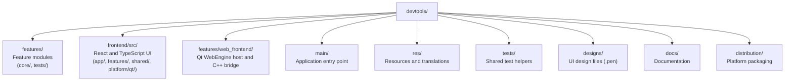

# Contributing to DevTools

[日本語版](docs/ja/CONTRIBUTING.md)

Thank you for your interest in contributing to DevTools! This document provides guidelines and instructions for contributing.

## Table of Contents

- [Code of Conduct](#code-of-conduct)
- [Getting Started](#getting-started)
- [How to Contribute](#how-to-contribute)
- [Development Guidelines](#development-guidelines)
- [Pull Request Process](#pull-request-process)
- [Release Process](#release-process)

## Code of Conduct

This project adheres to the [Contributor Covenant Code of Conduct](CODE_OF_CONDUCT.md). By participating, you are expected to uphold this code.

## Getting Started

### Prerequisites

Before contributing, make sure you have:

1. Read the [README](README.md)
2. Set up your development environment following [BUILD.md](BUILD.md)
3. Familiarized yourself with the project structure

### Project Structure



## How to Contribute

### Reporting Bugs

1. Check if the bug has already been reported in [Issues](https://github.com/LotusAndCompany/devtools/issues)
2. If not, create a new issue using the bug report template
3. Include:
   - Clear description of the bug
   - Steps to reproduce
   - Expected vs actual behavior
   - Environment information (macOS version, Qt version, etc.)
   - Screenshots if applicable

### Requesting Features

1. Check existing issues for similar feature requests
2. Create a new issue using the feature request template
3. Describe:
   - The problem you're trying to solve
   - Your proposed solution
   - Any alternatives you've considered

### Submitting Code

1. Fork the repository
2. Create a feature branch from `main`
3. Make your changes
4. Write or update tests as needed
5. Ensure all tests pass
6. Submit a pull request

## Development Guidelines

### Code Style

- Use C++17 features appropriately
- Follow existing code patterns in the project
- Use meaningful variable and function names
- Add comments for complex logic

### Localization

- For React UI, provide English and Japanese strings with the shared
  `text(locale, english, japanese)` helper.
- For native C++ UI, write source strings in English and wrap them with `tr()`.
- Track Japanese translations for native Qt text in `res/dev-tools_ja_JP.ts`.
- Do not add an English `.ts` file; English uses the source text
- Update `.ts` files only when native Qt strings change:
  `cmake --build build --target update_devtools_translations`

### React / Qt WebEngine UI with HMR

Install Bun 1.3.14, pinned in `frontend/package.json`, before using the frontend
commands. See the [Bun installation guide](https://bun.sh/docs/installation).

Start Vite in one terminal:

```bash
cd frontend
bun install --frozen-lockfile
bun run --bun dev
```

From the repository root, launch the Debug app in another terminal:

```bash
DEVTOOLS_WEB_UI_DEV_SERVER_URL=http://127.0.0.1:5173 cmake --build build --target run
```

Hot reload is available only in Debug builds and the app accepts only this
loopback URL. Release builds use the embedded frontend assets. See the
[React migration notes](docs/migration/m3-react-ui.md) for details.

### Frontend checks

Run these commands from `frontend/` before submitting frontend changes:

```bash
bun install --frozen-lockfile
bun run lint
bun run format:check
bun run --bun typecheck
bun run --bun build
bun run --bun test
```

CMake also runs the locked Bun install and production frontend build when it
builds the application target.

### Code Formatting

This project uses `clang-format` for automatic code formatting and `clang-tidy` for static analysis.

#### Setup

Install the tools (macOS):
```bash
brew install llvm
```

#### Usage

Format all source files:
```bash
cmake --build build --target format
```

Check formatting without changes:
```bash
cmake --build build --target format-check
```

Run static analysis:
```bash
cmake --build build --target lint
```

Run analysis with automatic fixes:
```bash
cmake --build build --target lint-fix
```

#### Git Hooks (pre-commit)

This project uses [pre-commit](https://pre-commit.com/) for automated code quality checks.

**Installation:**

```bash
# Install pre-commit
brew install pre-commit  # macOS
# or: pip install pre-commit

# Install hooks
pre-commit install --install-hooks -t pre-commit -t pre-push
```

**Hooks:**

| Stage | Hook | Description |
|-------|------|-------------|
| pre-commit | clang-format | Format C++ code |
| pre-commit | trailing-whitespace | Remove trailing whitespace |
| pre-commit | end-of-file-fixer | Ensure newline at EOF |
| pre-commit | check-added-large-files | Prevent large file commits |
| pre-push | cmake-build | Verify build succeeds |

**Manual Execution:**

```bash
# Run all hooks on all files
pre-commit run --all-files

# Run specific hook
pre-commit run clang-format --all-files

# Skip hooks temporarily
git commit --no-verify -m "WIP: work in progress"
git push --no-verify
```

**Updating Hooks:**

```bash
pre-commit autoupdate
```

#### CI (GitHub Actions)

The Code Quality workflow runs on pull requests to `main` when its configured
path filters match. The PR-title check runs on pull requests independently.

| Check | Runner | Description |
|-------|--------|-------------|
| Frontend Checks | Ubuntu | Oxlint, Oxfmt, TypeScript, Vite build, and Vitest |
| clang-format | macOS | Format check on changed files |
| clang-tidy | Ubuntu | Static analysis on changed files |
| format-suggestion | macOS | PR comment with format suggestions |
| semantic-pr | Ubuntu | Validate PR title follows Conventional Commits |

#### IDE Integration

- **Qt Creator**: Settings > C++ > Code Style > Import `.clang-format`
- **VS Code**: Install "clangd" extension, it will use `.clang-format` automatically
- **CLion**: Settings > Editor > Code Style > C/C++ > Enable ClangFormat

### Naming Conventions

| Type | Convention | Example |
|------|------------|---------|
| Classes | PascalCase | `ImageResize` |
| Functions | camelCase | `processImage()` |
| Variables | snake_case | `image_width` |
| Constants | SCREAMING_SNAKE_CASE | `MAX_IMAGE_SIZE` |
| Files | snake_case | `image_resize.cpp` |

### Adding Native C++ Services

Tool screens are implemented in React. Follow the
[Adding New Tools guide](docs/development/adding-new-tools.md) to add a screen
and connect it to native work when needed. C++ feature modules contain reusable
processing services; do not add per-feature Qt Widgets screens.

1. Create the feature directory structure:
   ```mermaid
   flowchart TD
       module["features/your_module/"]
       module --> cmake["CMakeLists.txt"]
       module --> core["core/"]
       core --> core_files["your_service.h<br/>your_service.cpp"]
       module --> tests["tests/"]
       tests --> test_file["test_your_module.cpp"]
   ```

2. Register the static library target in root `CMakeLists.txt`:
   ```cmake
   qt_add_library(${PROJECT_NAME}_your_module STATIC)
   ```

3. List service source files in `features/your_module/CMakeLists.txt`:
   ```cmake
   target_sources(DevTools_your_module PRIVATE
       core/your_service.h core/your_service.cpp
   )
   ```

4. Add to `MODULE_LIST` in root `CMakeLists.txt`:
   ```cmake
   set(MODULE_LIST
       # ... existing modules
       ${PROJECT_NAME}_your_module
   )
   ```

5. Register the module in `features/CMakeLists.txt`:
   ```cmake
   add_subdirectory(your_module)
   ```

### Adding Tests

Add tests to `tests/DevToolsTests.cmake`:
```cmake
DevTools_add_test(test_your_module
    SOURCES
    features/your_module/tests/test_your_module.cpp
)
```

Enable C++ tests from the repository root, keeping the vcpkg toolchain and
triplet used by the application build:

```bash
cmake -S . -B build \
  -DCMAKE_TOOLCHAIN_FILE="$VCPKG_ROOT/scripts/buildsystems/vcpkg.cmake" \
  -DVCPKG_TARGET_TRIPLET=arm64-osx \
  -DENABLE_UNIT_TEST=ON
cmake --build build --parallel
ctest --test-dir build --output-on-failure
```

### Design Files

UI design files (`.pen`, [Pencil](https://pencil.app) format) are stored under `designs/screens/`, with one file per screen or dialog group. Common chrome such as the sidebar is intentionally excluded from individual screen files to keep edits localized.

See [Design Files](docs/development/design-files.md) for the full layout, editing workflow, and conflict-handling guidance.

## Pull Request Process

1. **Update documentation** if needed
2. **Write tests** for new functionality
3. **Ensure CI passes** (all tests pass, no build errors)
4. **Request review** from maintainers
5. **Address feedback** promptly
6. **Squash-merge the pull request**

### PR Title Format

Use a clear, descriptive title following the [Conventional Commits](https://www.conventionalcommits.org/) format.
The title is automatically validated by CI.

**Rules:**
- Start the subject (after the colon) with a lowercase letter
- Use present tense ("add feature" not "added feature")

**Examples:**
- `feat: add SMS QR code generation`
- `fix: correct image rotation angle calculation`
- `docs: update build instructions for macOS`
- `refactor: simplify data conversion logic`

### Review Process

1. A maintainer will review your PR
2. They may request changes or ask questions
3. Once approved, the PR will be merged
4. Your contribution will be acknowledged in the changelog

## Release Process

This project uses [release-please](https://github.com/googleapis/release-please) for automated release management.

### How It Works

1. **Squash-merged PR titles determine version bumps:**
   - The PR title becomes the squash commit title on `main`
   - `fix:` PR titles → PATCH release
   - `feat:` PR titles → MINOR release
   - `feat!` or `fix!` in the PR title → MAJOR release

2. **Automated workflow:**
   - When changes are merged to `main`, release-please creates/updates a Release PR
   - The Release PR includes:
     - Updated `CHANGELOG.md`
     - Version bumps in `CMakeLists.txt` and `vcpkg.json`
   - When the Release PR is merged, a GitHub Release and tag are created automatically

3. **Version files managed by release-please:**
   - `CMakeLists.txt` - Project version
   - `vcpkg.json` - Dependencies version
   - `version.txt` - Plain text version
   - `CHANGELOG.md` - Release notes

### For Maintainers

- Review and merge the automated Release PR when ready to release
- Do not manually edit version numbers or CHANGELOG (release-please handles this)
- Ensure PR titles follow Conventional Commits; release-please reads the
  squash commit title on `main` for version determination

## Questions?

If you have questions, feel free to:
- Open an issue for discussion
- Contact the maintainers

Thank you for contributing to DevTools!
