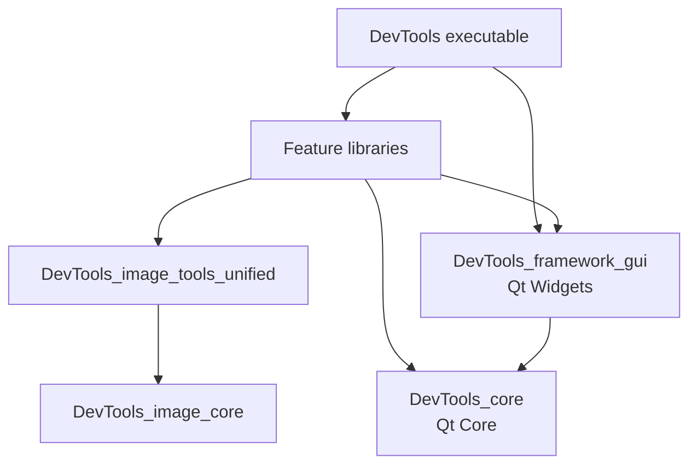
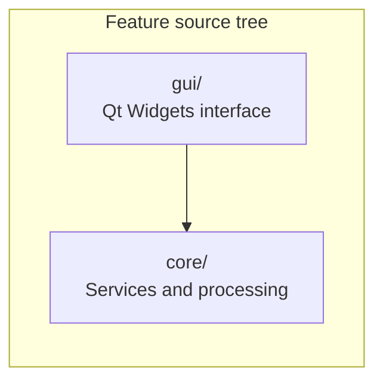
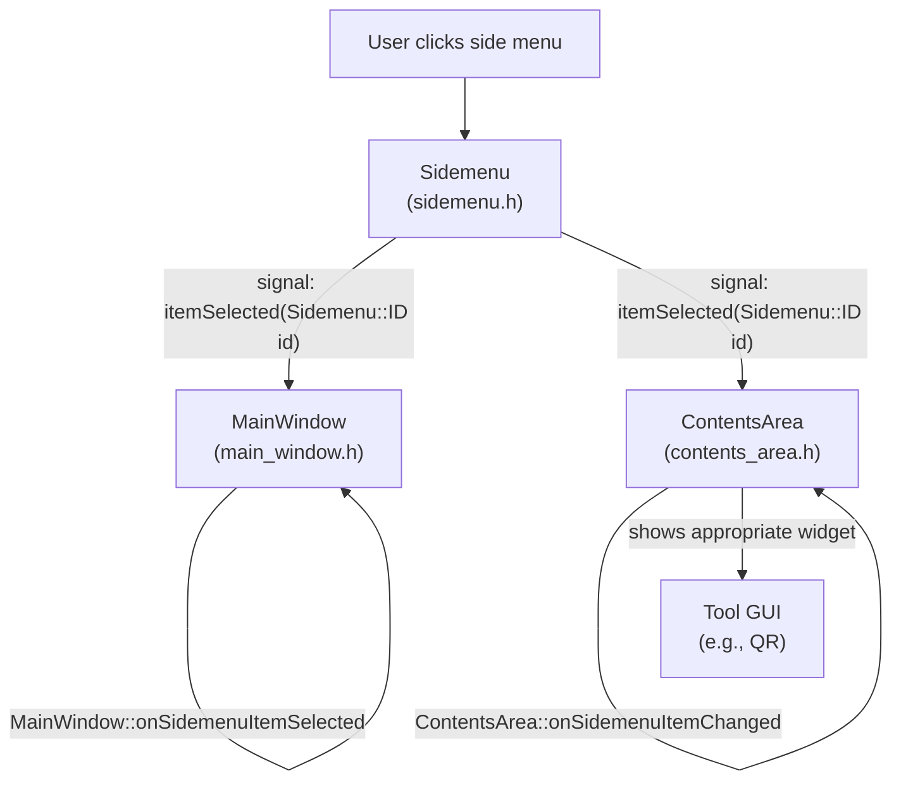
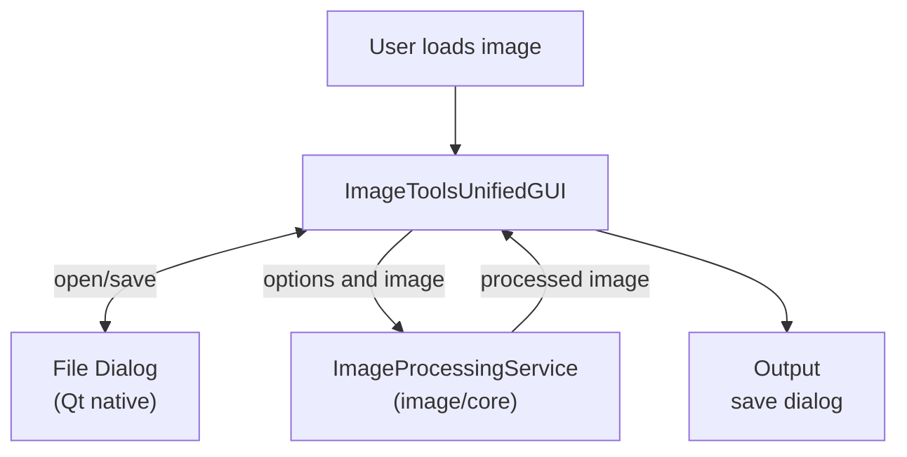
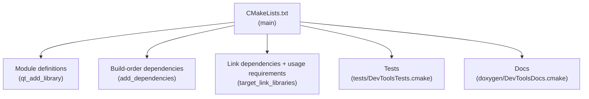
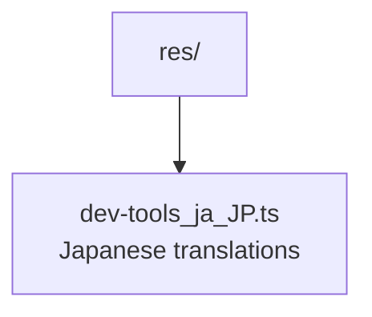
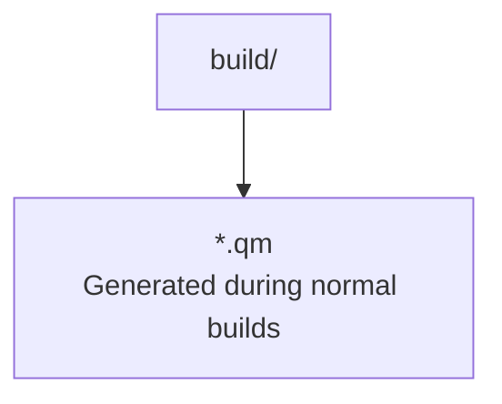
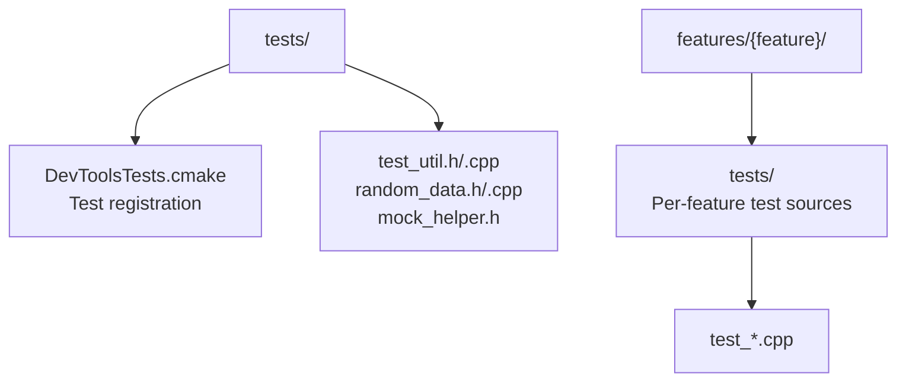

# System Architecture

This document describes the architecture of DevTools, including module structure, dependencies, and design patterns.

## Overview

DevTools is a Qt6-based desktop application built with C++17. The architecture uses a modular static library design to reduce compilation time and improve code organization.

## Technology Stack

| Component | Technology |
|-----------|------------|
| Language | C++17 |
| GUI Framework | Qt 6.9+ (Widgets) |
| Build System | CMake 3.21.1+ |
| Package Manager | vcpkg |
| Code Formatting | clang-format |
| Static Analysis | clang-tidy |

## Directory Structure

Each feature lives under `features/{feature}/` with `core/`, `gui/`, and
`tests/` subdirectories. Shared framework code lives in `features/framework/`:
non-Widget classes are compiled as `DevTools_core`, while most shared GUI classes
are compiled as `DevTools_framework_gui`. `ContentsArea` remains part of the
application executable. Feature libraries still list their `core/` and `gui/`
sources in the same target. The separation is at the source dependency level:
feature `core/` code does not include Qt Widgets, the shared GUI framework, or
feature GUI headers.

```mermaid
flowchart TD
    root["devtools/"]
    root --> features["features/<br/>Feature modules<br/>(core/, gui/, tests/)"]
    features --> framework["framework/<br/>Shared framework"]
    framework --> framework_core["DevTools_core<br/>Non-Widget framework"]
    framework --> framework_gui["DevTools_framework_gui<br/>Application shell and shared widgets"]
    features --> conversion["data_conversion/<br/>JSON/YAML/TOML conversion"]
    features --> qr["qr_code/<br/>QR code generation"]
    features --> image["image/<br/>Resize, rotation, division, transparency"]
    features --> db["db_tool/<br/>Database tool"]
    features --> http["http_request/<br/>HTTP API testing"]
    features --> command["command/<br/>Shell command execution"]
    features --> phrase["phrase_generation/<br/>Random phrase generation"]
    features --> regex["regex_tool/<br/>Regular expression testing"]
    features --> timestamp["timestamp_conversion/<br/>Unix/date-time/ISO 8601 conversion"]
    root --> main["main/<br/>Application entry point"]
    root --> resources["res/"]
    resources --> qrc["*.qrc<br/>Qt resource files"]
    resources --> themes["themes/<br/>qlementine theme JSON files"]
    resources --> fonts["fonts/<br/>Material Symbols icon font"]
    resources --> translations["*.ts<br/>Translation files"]
    root --> tests["tests/<br/>Shared test helpers<br/>(per-feature tests live in features/{feature}/tests/)"]
    root --> distribution["distribution/<br/>Packaging files"]
```



## Module Architecture

### Module Diagram



The root CMake file links feature libraries to both shared framework targets.
Their `core/` sources still have no source-level dependency on the GUI target.
`DevTools_image_tools_unified` also depends on `DevTools_image_core`.

### Shared Framework Targets

| Module | Description | Dependencies |
|--------|-------------|--------------|
| `DevTools_core` | Non-Widget framework services, tool base, and exceptions | Qt6::Core |
| `DevTools_framework_gui` | Shared application GUI, widgets, dialogs, and design system | DevTools_core, Qt6::Core, Qt6::Gui, Qt6::Widgets, qlementine |

Feature targets are declared in the root `CMakeLists.txt` and list their sources
in `features/{feature}/CMakeLists.txt`. The root currently links them to both
shared framework targets and the application Qt modules. Data conversion also
links yaml-cpp and toml11; `DevTools_image_tools_unified` links
`DevTools_image_core`. The registered target names are listed in `MODULE_LIST`
in the root CMake file.

### Shared Framework Structure

Both targets are implemented in `features/framework/`; their sources are listed
with `target_sources()` in `features/framework/CMakeLists.txt`:

- **`DevTools_core`**: `application_settings_service`, `local_file_selection_service`, `application_mixin`, `Tool`, and exception classes under `features/framework/core/`
- **`DevTools_framework_gui`**: `GuiApplication`, `MainWindow`, navigation, dialogs, the shared UI design system, and `GuiTool` under `features/framework/gui/`

The detailed feature service boundaries and remaining Qt dependencies are
recorded in the [M1 architecture inventory](../migration/m1-architecture-inventory.md).

## Design Patterns

### Core and GUI Source Boundary

Each tool follows a similar pattern:



- **core/**: Services and feature processing. Do not include Qt Widgets, shared GUI framework headers, or feature GUI headers. Other Qt modules and value types may be used when the processing requires them.
- **gui/**: Collects input, presents localized errors and results, and calls the feature's core services.

This is a source dependency rule; it does not mean every feature has a separate
core library. Most feature targets still compile both source directories into
one static library.

### Static Library Pattern

Each feature is compiled as a static library (`STATIC`). The library target is
declared in the root `CMakeLists.txt` with `qt_add_library(${PROJECT_NAME}_your_module STATIC)`
and the source files are listed in `features/your_module/CMakeLists.txt` via
`target_sources()`. The feature is then registered in `features/CMakeLists.txt`
with `add_subdirectory()`.

```cmake
# Root CMakeLists.txt
qt_add_library(${PROJECT_NAME}_your_module STATIC)

# features/your_module/CMakeLists.txt
target_sources(${PROJECT_NAME}_your_module PRIVATE
    core/your_module.h core/your_module.cpp
    gui/your_module_gui.h gui/your_module_gui.cpp
)
```

Benefits:
- Reduced compilation time (only changed modules recompile)
- Clear module boundaries
- Easier testing

## Data Flow

### Tool Selection Flow



### Image Processing Flow



## External Dependencies

### Qt6 Modules

| Module | Purpose |
|--------|---------|
| Qt6::Core | Core functionality |
| Qt6::Widgets | GUI components |
| Qt6::Network | HTTP requests |
| Qt6::Sql | Database operations |
| Qt6::LinguistTools | Translations |
| Qt6::Svg | SVG support required by qlementine |

### vcpkg Libraries

| Library | Purpose | Linking |
|---------|---------|---------|
| toml11 | TOML parsing | Header-only |
| yaml-cpp | YAML parsing | Static |

### Bundled Libraries

| Library | Purpose | Source |
|---------|---------|--------|
| qrcodegen | QR code generation | Project Nayuki |

### FetchContent Libraries

| Library | Purpose | Source |
|---------|---------|--------|
| qlementine v1.4.2 | Modern Qt Widgets `QStyle` and JSON theme support | `https://github.com/oclero/qlementine.git` |

qlementine is fetched by CMake instead of vcpkg because it is built against the active
system Qt6 installation. The project disables qlementine's sandbox and showcase targets and
links the style library into `DevTools_framework_gui`.

## Application Styling and Themes

DevTools uses qlementine as the application-wide `QStyle`:

1. `GuiApplication::setup()` creates `oclero::qlementine::QlementineStyle` and installs it
   with `QApplication::setStyle()`.
2. `oclero::qlementine::ThemeManager` loads JSON themes from the Qt resource prefix
   `:/themes`.
3. `GuiApplication::applyColorScheme()` maps the system color scheme to the qlementine
   `Light` or `Dark` theme and refreshes the Material Symbols icon theme.

Theme JSON files live in `res/themes/` and are registered in `res/application.qrc`. When
adding or renaming a theme, keep the `meta.name` value unique because qlementine's
`ThemeManager` uses it as the theme identifier.

Feature GUIs use `DevTools::Ui` for shared layout, widget configuration, and metrics.
Colors, borders, and text roles come from the active qlementine style.

### UI Consistency Contract

Every screen is composed from the shared UI contract in
`features/framework/gui/design_system.h` and `.cpp`. The contract defines page,
content, panel, toolbar, and inline layout roles, along with standard and
compact panes, form fields, code editors, status views, item views, table views,
splitters, and dialog footers.

Display-only text uses `configureDisplayTextControl`: it keeps the normal
qlementine frame and standard font while disabling focus and hover state.
Selectable output must explicitly opt into keyboard and mouse text selection.
Flat collections use list widgets; hierarchical data uses tree widgets. All
list and table views use the shared item-view configuration so fonts, selection
behavior, and row treatment do not drift between tools. List views own their
shared rounded frame; feature panes must not wrap them in a second framed
surface. Table and tree views use the containing pane as their outer frame.
qlementine remains responsible for row, selection, and table separator
rendering, while list viewports stay transparent so their rounded corners remain
visible.

All text controls use the standard system font through the design-system
helpers. Code-specific helpers may add behavior such as tab-stop configuration,
but must not introduce a separate font or private widget styling.

Screen-specific composition remains allowed when it reflects the tool's real
workflow. The same UI role must use the same shared configuration, however. A
feature GUI must not introduce private fonts, colors, CSS, control dimensions,
or duplicated spacing values for a role already covered by `DevTools::Ui`.

When adding a reusable role, extend the design system first and add a focused
GUI test in `features/framework/tests/test_design_system.cpp`. Keep color and
typography decisions in the active qlementine theme or the design-system
helpers so that light and dark themes behave identically.

## Build System

### CMake Structure



### Build Targets

| Target | Description |
|--------|-------------|
| `DevTools` | Main executable |
| `format` | Run clang-format |
| `format-check` | Check formatting |
| `lint` | Run clang-tidy |
| `lint-fix` | Run clang-tidy with fixes |
| `run` | Build and launch DevTools |
| `quality-check` | Run all quality checks |
| `DevTools_docs` | Generate Doxygen docs |

## Translation System

DevTools supports multiple languages using Qt translation tools:

Tracked translation sources:



Generated translation artifacts:



Translation workflow:
1. Write source strings in English and mark them with `tr()` in code
2. Run `cmake --build build --target update_devtools_translations` when strings change
3. Update the tracked `.ts` translations
4. Normal builds run `lrelease` to compile `.qm` files

## Testing Architecture

Per-feature tests live alongside the feature under `features/{feature}/tests/`.
Shared test helpers (mock utilities, random data generators) live under
`tests/`.



Tests are registered in `tests/DevToolsTests.cmake` via `DevTools_add_test()`.
See [Testing Guide](testing-guide.md) for details.

## Related Documentation

- [Adding New Tools](adding-new-tools.md) - How to add new tool modules
- [Coding Standards](coding-standards.md) - Code style guidelines
- [Testing Guide](testing-guide.md) - How to write tests
