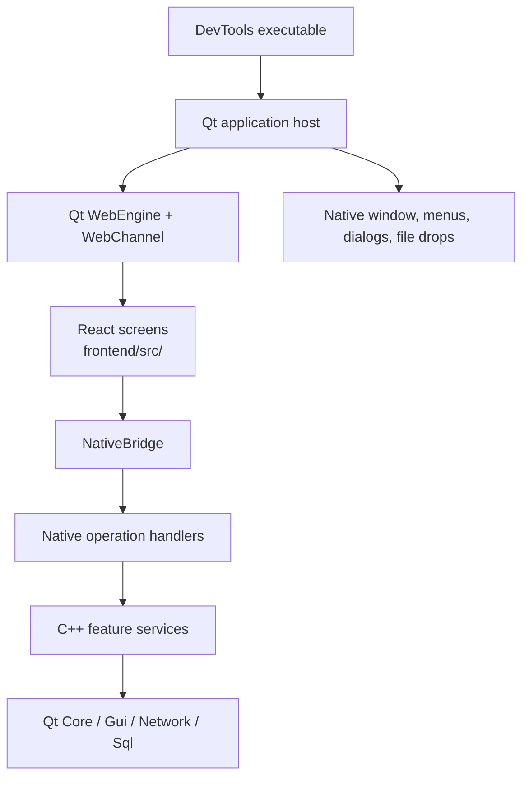
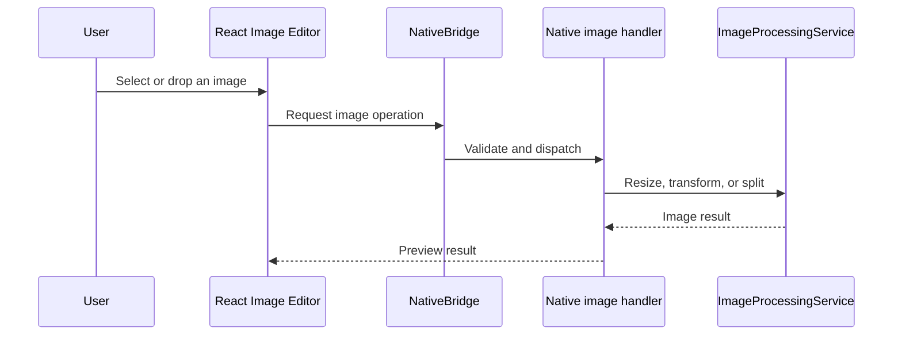

# System Architecture

DevTools is a C++17 macOS application with a React frontend hosted by Qt
WebEngine. React owns all feature screens. The Qt host owns the native window,
menus, OS dialogs, clipboard integration, file drops, and the bridge to C++
processing services.

## Technology Stack

| Component | Technology |
|-----------|------------|
| Native host and processing | C++17, Qt 6.9+ |
| Feature screens | React, TypeScript, shadcn components |
| Web assets | Vite, Bun 1.3.14 |
| Build system | CMake 3.21.1+ |
| C++ package manager | vcpkg |

## Directory Structure

```text
devtools/
├── frontend/src/
│   ├── app/                    React shell, navigation, tool registry
│   ├── features/{feature}/     React tool screens
│   ├── shared/                 Shared UI, bridge contracts, helpers
│   └── platform/qt/            Qt WebChannel adapter
├── features/
│   ├── framework/core/         Settings, file selection, app services
│   ├── framework/gui/          QApplication and native MainWindow
│   ├── web_frontend/           WebEngine host, bridge, native handlers
│   └── {feature}/core/         C++ processing services
├── res/                        Qt resources, themes, translations
├── tests/                      Shared C++ test helpers
└── distribution/               Packaging files
```

Feature modules contain reusable processing code and tests. They do not
contain Qt Widgets screens. Qt Widgets remains in the host for native window
and platform integration; `features/web_frontend/` contains native dialogs and
the WebEngine bridge required by the React UI.

## Module Architecture



| Module | Responsibility |
|--------|----------------|
| `DevTools_core` | Shared settings, file selection, application mixin, and errors |
| `DevTools_framework_gui` | QApplication setup and the native MainWindow host |
| Feature libraries | C++ processing services used by bridge operations |
| `DevTools_web_frontend` | React asset hosting, bridge validation, native dialogs, and operation dispatch |

The WebEngine bridge validates operation names and payloads before calling
feature services. File paths and OS-specific resources stay in the native
process. The frontend receives typed operation results and never calls
Qt WebChannel directly from feature screens.

## Feature Boundaries

- **React feature screen**: owns presentation, input state, accessibility, and
  user interaction for one tool.
- **C++ feature service**: owns reusable processing and domain behavior. Keep
  platform dialogs and WebEngine APIs out of feature services.
- **Native operation handler**: validates the bridge request, coordinates
  native resources, and calls the appropriate C++ service.
- **Qt host**: owns application lifecycle, window behavior, OS integration,
  and the WebEngine security boundary.

When a tool needs native work, register a typed operation in
`frontend/src/shared/bridge/types.ts`, implement it under
`features/web_frontend/`, and call the service under
`features/{feature}/core/`. See [Adding New Tools](adding-new-tools.md).

## CMake Modules

Static library targets are declared in the root `CMakeLists.txt`. Each feature
lists its service sources in `features/{feature}/CMakeLists.txt`; the module is
registered through `features/CMakeLists.txt`.

```cmake
# Root CMakeLists.txt
qt_add_library(${PROJECT_NAME}_your_feature STATIC)

# features/your_feature/CMakeLists.txt
target_sources(DevTools_your_feature PRIVATE
    core/your_service.h
    core/your_service.cpp
)
```

Link only the Qt modules required by the service. `DevTools_web_frontend` links
the feature libraries and the Qt Widgets/WebEngine modules used by native
integration.

## Data Flow: Image Processing



The native host keeps file paths and OS dialogs in C++. The React screen receives
image data and operation results through the typed bridge contract.

## External Dependencies

| Dependency | Purpose |
|------------|---------|
| Qt 6 Core, Gui, Widgets, Network, Sql, WebChannel, WebEngine | Native host and feature services |
| qlementine | Theme and style for native Qt host widgets |
| toml11, yaml-cpp | Data conversion |
| qrcodegen | QR code generation |
| Bun packages | React UI and frontend build |
