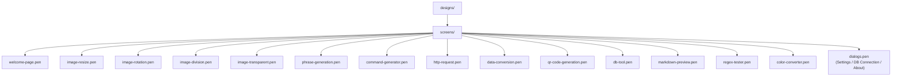

# Design Files

UI design files (`.pen`, [Pencil](https://pencil.app) format) are stored under
`designs/screens/`. Most designs correspond to the current React tool screens;
the Color Converter design is not part of the 11 tools currently in the app.
Use the [user guide overview](../user-guide/overview.md) as the current tool
inventory. Design files are visual references; implement screens with the
shared components and styling conventions in the
[UI development guide](ui-development.md).

## File Layout

One file per screen (or per related dialog group). The sidebar and other shared chrome are intentionally excluded from individual screen files so that an edit to one screen never touches another.

## Editing Workflow

1. Open the target file directly in the Pencil editor (do not use the master file pattern — there is no master).
2. Edit only the screen contained in the file. If a change requires touching the sidebar or another shared component, raise it as a separate discussion before introducing it.
3. Save and commit. Prefer one screen per pull request.

## Reusable Components

Pencil objects are visual shapes, not React components. For the React
implementation, reuse the primitives in
`frontend/src/shared/components/ui/` and app-specific components in
`frontend/src/shared/components/`. Keep screen-specific composition inside its
feature; only promote a component to shared UI when multiple features use it.

## Git Handling

`.pen` files are tracked as regular files — no `binary` / `merge=binary` attributes are applied. Git will attempt text-based diff and auto-merge.

In practice, `.pen` payloads are encrypted, so a textual auto-merge can produce an unreadable file. Mitigations:

- Keep edits localized to one screen file per PR.
- Coordinate with the team before editing a `.pen` file someone else may also be touching.
- If a conflict does occur, open both branches' versions in Pencil, decide which to keep with `git checkout --ours <file>` / `--theirs <file>`, and re-apply the other branch's intent manually.

## Best Practices

- **One screen per PR** when possible — keeps diffs reviewable and reduces conflict risk.
- **Communicate** before editing shared screens.
- **Descriptive commits** so reviewers understand the design intent without opening the editor.
