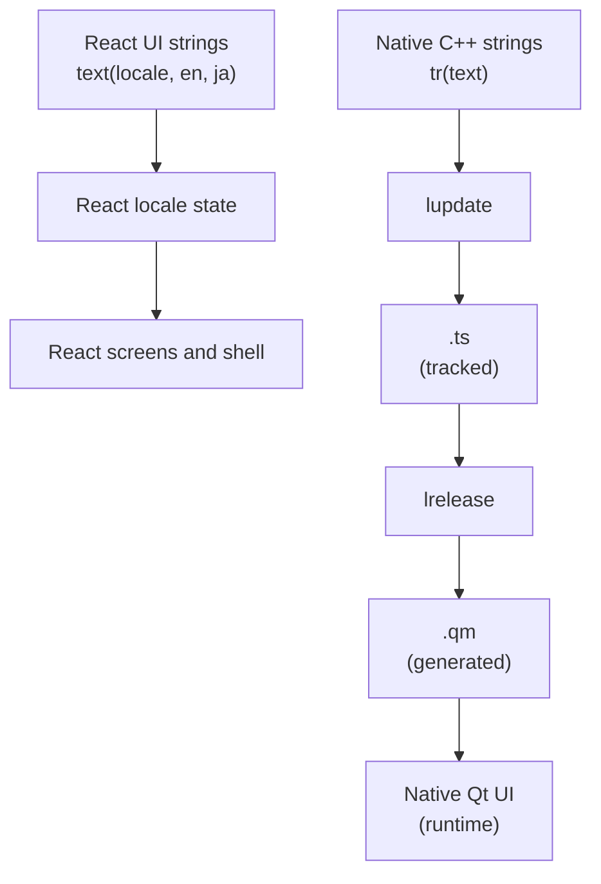
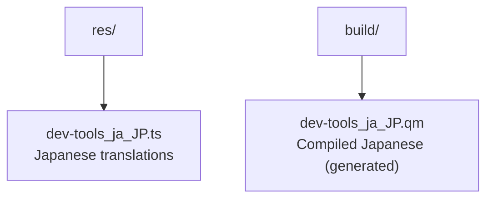

# Localization Guide

This guide explains how to add and manage translations in DevTools.

## Overview

The application has two translation paths. The regular tool screens and React
shell use English/Japanese strings in TypeScript. Native Qt menus, file dialogs,
and bridge messages use Qt Linguist translations. Currently supported languages:

- English (en) - Default source language, no `.ts` file
- Japanese (ja_JP)

For React text, use the `text(locale, english, japanese)` helper and pass the
active `locale` through the screen props. Tool names and descriptions belong in
`frontend/src/app/tool-registry.ts`. React strings are not extracted into the
Qt `.ts` file. For native C++ text, use `tr()` and update
`res/dev-tools_ja_JP.ts`.

## How It Works



1. **Native C++ source**: English strings marked with `tr()`
2. **lupdate**: Extracts strings to `.ts` files when explicitly requested
3. **`.ts` files**: XML translation source files tracked in Git
4. **lrelease**: Compiles to binary `.qm` files during normal builds
5. **Runtime**: The Qt application loads `.qm` files for translated native UI; English uses the source text

## Translation Files



## Marking Strings for Translation

### In C++ Code

```cpp
// Basic translation. Use English as the source string.
QString message = tr("Hello, World!");

// With context (for disambiguation)
QString save = tr("Save", "file operation");
QString save2 = tr("Save", "game operation");

// With arguments
QString greeting = tr("Hello, %1!").arg(userName);

// Plural forms
QString items = tr("%n item(s)", "", count);
```

## Updating Translations

### Using CMake

```bash
# Update .ts files with new strings
cmake --build build --target update_devtools_translations

# Compile .qm files
cmake --build build --target release_devtools_translations
```

### Manual Commands

```bash
# Update specific .ts file
lupdate -locations none -no-obsolete -recursive . -ts res/dev-tools_ja_JP.ts

# Compile to .qm
lrelease res/dev-tools_ja_JP.ts
```

## Editing Translations

Edit the tracked `.ts` files when translation text changes. The update target uses
`-locations none -no-obsolete` so source line numbers and obsolete messages do not create
unrelated diffs.

### Translation Entry Shape

```xml
<context>
    <name>SettingsDialog</name>
    <message>
        <source>Language:</source>
        <translation>言語:</translation>
    </message>
</context>
```

## Adding a New Language

### 1. Update CMakeLists.txt

```cmake
qt_standard_project_setup(I18N_TRANSLATED_LANGUAGES ja_JP fr)  # Add 'fr'
```

### 2. Add Translation File

```cmake
set(TRANSLATION_TS_FILES
    res/dev-tools_ja_JP.ts
    res/dev-tools_fr.ts
)
```

### 3. Update and Translate

```bash
cmake --build build --target update_devtools_translations
```

### 4. Update Language Selection

Add the new language to the settings dialog.

## Best Practices

### String Guidelines

```cpp
// Good: Complete sentences
tr("The file could not be saved.")

// Bad: Sentence fragments
tr("could not be") + tr("saved")  // Breaks in other languages

// Good: Use arguments for dynamic content
tr("File '%1' saved successfully.").arg(filename)

// Bad: Concatenation
tr("File '") + filename + tr("' saved successfully.")
```

### Context for Disambiguation

```cpp
// When same English word has different meanings
tr("Open", "menu action");      // メニュー: 開く
tr("Open", "file state");       // ファイル状態: 開いている

// Class name is automatic context
class SaveDialog : public QDialog {
    // Strings here have context "SaveDialog"
    tr("Save");  // Context: SaveDialog
};
```

### Handling Plurals

```cpp
// English: "1 file" / "2 files"
// Japanese: "1 ファイル" / "2 ファイル" (same form)

int count = 5;
QString text = tr("%n file(s) selected", "", count);
```

### Numbers and Dates

```cpp
// Use locale-aware formatting
QLocale locale;
QString number = locale.toString(12345.67);  // "12,345.67" or "12.345,67"
QString date = locale.toString(QDate::currentDate());
```

## Testing Translations

### Switch Language at Runtime

For testing, you can switch language in settings:

1. Open **Settings** from the sidebar.
2. Choose **English** or **日本語** in **Language**.
3. Click **Save**. The React interface changes immediately.

This setting also updates the language used by native Qt menus and dialogs.

### Check for Untranslated Strings

```bash
# Refresh the source inventory and then verify that every entry is translated
cmake --build build --target update_devtools_translations
cmake --build build --target check_devtools_translations
```

The check target fails when the Japanese `.ts` file contains an unfinished or
empty translation. Run it after adding or changing native Qt strings; React
strings are checked in the TypeScript source and are not included in this
target.

### Visual Testing

1. Switch to target language
2. Navigate through all screens
3. Check for:
   - Truncated text
   - Layout issues
   - Missing translations
   - Wrong context translations

### Shared Qt Widgets and Localization

Use the shared UI contract in `features/framework/gui/design_system.*` when
adding or changing native or legacy Qt Widgets controls. Shared field, pane,
action-bar, and dialog-footer helpers provide the size policies and spacing
that allow English and Japanese text to fit consistently.

Do not compensate for a translation with a screen-specific fixed width, font,
or stylesheet. Prefer layouts and size hints; if a reusable role cannot fit a
translation, update the shared helper and add a focused UI regression test.

### Runtime Language Changes in Qt Widgets

Every native or legacy Qt Widgets screen that keeps user-visible labels, pane
titles, button text, placeholders, combo-box items, or table headers must
provide a `retranslateUi()`
method and handle `QEvent::LanguageChange`. Text created only in a constructor
will remain in the old language when the user changes the language while the
screen is open. Preserve user data and selection state while refreshing the
labels and translated item text.

Use `tr()` at the point where runtime messages are shown as well, so dialogs,
errors, and status messages use the language active at the time of the action.

React screens receive the current `locale` prop and render both language
variants with `text(locale, english, japanese)`. React does not use
`QEvent::LanguageChange` or `retranslateUi()`.

## Common Issues

### Text Truncation

```cpp
// Problem: Fixed-size button
button->setFixedWidth(100);  // May truncate translations

// Solution: Use size hints
button->setSizePolicy(QSizePolicy::Minimum, QSizePolicy::Fixed);
```

### Layout Breaking

- Use layouts that resize
- Avoid fixed sizes for text elements
- Test with longest translations

### Missing Translations

For native Qt text:

1. Check that the source string uses `tr()`.
2. Run `cmake --build build --target update_devtools_translations`.
3. Find `type="unfinished"` entries in the `.ts` file.

For React text, check both language arguments at the call site and verify the
screen in English and Japanese. The Qt translation target does not inspect
React strings.

## Translation Workflow

### For Developers

1. For React UI, add both English and Japanese text at the component call site.
2. For native Qt UI, mark source text with `tr()`.
3. Run `cmake --build build --target update_devtools_translations` for Qt text.
4. Update `.ts` translations when needed and commit them with the code change.

### Release Preparation

1. Ensure all strings translated
2. Run `cmake --build build --target release_devtools_translations`
3. Test in target language
4. Keep `.qm` files as generated build artifacts

## Related Documentation

- [Adding New Tools](adding-new-tools.md) - Module creation
- [Coding Standards](coding-standards.md) - Code style
- [Qt Internationalization](https://doc.qt.io/qt-6/localization.html)
