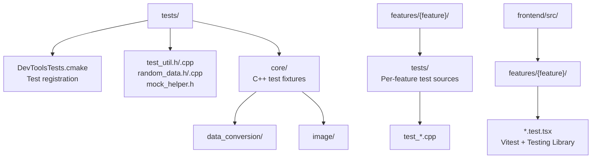

# Testing Guide

This guide explains how to write and run tests for DevTools.

## Overview

DevTools uses Qt Test for C++ services and native bridge integration, and
Vitest with Testing Library for React behavior. Tests cover feature processing,
the Qt WebEngine bridge, and screen interactions. C++ test cases are methods on
a `QObject` test class. `QTEST_GUILESS_MAIN` starts a `QCoreApplication` for
service tests; Qt WebEngine integration tests use a GUI application.

## Test Structure

Test sources live alongside each feature under `features/{feature}/tests/`.
Shared test helpers and test data live under the top-level `tests/` directory.
React tests live beside their feature in `frontend/src/features/` or beside
the shared bridge code they exercise.



## Enabling Tests

Native C++ tests are disabled by default. Configure them with CMake, preserving
the vcpkg toolchain used for the application:

```bash
# Configure from the repository root (set VCPKG_ROOT first)
cmake -S . -B build \
  -DCMAKE_TOOLCHAIN_FILE="$VCPKG_ROOT/scripts/buildsystems/vcpkg.cmake" \
  -DVCPKG_TARGET_TRIPLET=arm64-osx \
  -DENABLE_UNIT_TEST=ON

# Build the application and C++ tests
cmake --build build --parallel

# Run all registered C++ tests
ctest --test-dir build --output-on-failure
```

## React Frontend Tests

From `frontend/`, install the locked dependencies and run the checks used by
the Code Quality workflow:

```bash
bun install --frozen-lockfile
bun run lint
bun run format:check
bun run --bun typecheck
bun run --bun test
bun run --bun build
```

Vitest and Testing Library tests should cover observable screen behavior such
as user input, button actions, validation, empty states, and rendered results.
Keep the tests beside the feature or shared bridge module they cover.

## Writing Tests

### Basic Test Structure

```cpp
#include "features/your_module/core/your_class.h"

#include <QtTest>

class TestMyClass : public QObject
{
    Q_OBJECT

private slots:
    void init();
    void cleanup();
    void methodReturnsExpectedValue();
};

void TestMyClass::init()
{
    // Set up state before each test method.
}

void TestMyClass::cleanup()
{
    // Release state after each test method when needed.
}

void TestMyClass::methodReturnsExpectedValue()
{
    MyClass object;
    QCOMPARE(object.method(), expected_value);
}

QTEST_GUILESS_MAIN(TestMyClass)
#include "test_my_class.moc"
```

### React UI and Qt WebEngine Coverage

React tests should cover observable screen behavior: editing inputs, invoking
actions, validation, empty states, and rendered results. Keep them beside the
feature or shared component they exercise.

`features/web_frontend/tests/test_qt_webengine_frontend.cpp` covers the bundled
React app and the WebEngine/native bridge boundary. Extend it when changing
route loading, bridge operations, native file handling, or integration behavior.
For a UI-wide change, manually open the registered tools and check relevant
empty/error/result states, window resizing, light and dark themes, and English
and Japanese text.

### Test Macros

| Qt Test macro | Description |
|---------------|-------------|
| `QCOMPARE(actual, expected)` | Compare values and report both values on failure |
| `QVERIFY(condition)` | Check a condition; stop the current test method on failure |
| `QVERIFY2(condition, message)` | Check a condition with a custom failure message |
| `QVERIFY_EXCEPTION_THROWN(expression, Exception)` | Check that an expression throws the given exception |
| `QSKIP(message)` | Skip the current test method |

### Testing Exceptions

```cpp
#include "features/framework/core/exception/invalid_argument_exception.h"

#include <QtTest>

class TestValidation : public QObject
{
    Q_OBJECT

private slots:
    void rejectsInvalidInput();
};

void TestValidation::rejectsInvalidInput()
{
    MyClass object;
    QVERIFY_EXCEPTION_THROWN(object.process(-1), InvalidArgumentException);
}

QTEST_GUILESS_MAIN(TestValidation)
#include "test_validation.moc"
```

### Testing with Qt Types

```cpp
#include <QString>
#include <QImage>
#include <QtTest>

class TestImage : public QObject
{
    Q_OBJECT

private slots:
    void loadsValidImage();
};

void TestImage::loadsValidImage()
{
    const QImage image(100, 50, QImage::Format_ARGB32);
    QVERIFY(!image.isNull());
    QCOMPARE(image.width(), 100);
    QCOMPARE(image.height(), 50);
}

QTEST_GUILESS_MAIN(TestImage)
#include "test_image.moc"
```

## Test Categories

### Core Logic Tests

Test business logic without GUI dependencies:

```cpp
// features/data_conversion/tests/test_json_parser.cpp
#include "features/data_conversion/core/parser/json_parser.h"

#include <QtTest>

class TestJsonParser : public QObject
{
    Q_OBJECT

private slots:
    void parsesValidJson();
    void rejectsInvalidJson();
};

void TestJsonParser::parsesValidJson()
{
    JsonParser parser;
    auto result = parser.parse("{\"key\": \"value\"}");
    QVERIFY(result.has_value());
}

void TestJsonParser::rejectsInvalidJson()
{
    JsonParser parser;
    auto result = parser.parse("not json");
    QVERIFY(!result.has_value());
}

QTEST_GUILESS_MAIN(TestJsonParser)
#include "test_json_parser.moc"
```

### Qt WebEngine Integration Tests

Use `QTEST_MAIN` for tests that create the Qt WebEngine host or native dialogs.
Keep these tests focused on host and bridge integration; feature presentation is
tested through React. A headless test environment may require
`QT_QPA_PLATFORM=offscreen` and the Qt WebEngine runtime setup.

## Registering Tests

Add tests to `tests/DevToolsTests.cmake`:

```cmake
# A test that uses feature libraries and shared test helpers.
DevTools_add_test(test_your_module
    SOURCES
    features/your_module/tests/test_your_module.cpp
)

# A service test compiled without the shared GUI/test library.
DevTools_add_test(test_your_service CORE_ONLY
    SOURCES
    features/your_module/tests/test_your_service.cpp
    features/your_module/core/your_service.cpp
)

# Add only the Qt module required by the service implementation, if needed.
target_link_libraries(test_your_service PRIVATE Qt6::Network)
```

`DevTools_add_test` is defined in `tests/DevToolsTests.cmake`. The default
path links the shared test library and application feature modules. Use
`CORE_ONLY` for a test that compiles service source files directly without that
library; the helper then links only Qt Core and Qt Test. Add any other required
Qt module, such as Qt Gui, Network, or Sql, with `target_link_libraries()` after
the registration. Include the service implementation source in `SOURCES`.

## Test Helpers

### Mock Helper

`tests/mock_helper.h` provides `Test::FunctionMock<Signature>`. It can replace
a function's behavior and record its call count and arguments:

```cpp
#include "tests/mock_helper.h"

#include <QtTest>

Test::FunctionMock<int(int)> mock([](int value) { return value + 1; });
QCOMPARE(mock(2), 3);
QCOMPARE(mock.count(), size_t(1));
```

### Random Data Generator

`tests/random_data.h` provides `Test::RandomData`. Pass a seed when repeatable
input is useful:

```cpp
#include "tests/random_data.h"

#include <QtTest>

class TestProcessor : public QObject
{
    Q_OBJECT

private slots:
    void handlesRandomInput();
};

void TestProcessor::handlesRandomInput()
{
    Test::RandomData random(123);
    const QString input = random.nextQString(100);
    QCOMPARE(input.size(), 100);
}

QTEST_GUILESS_MAIN(TestProcessor)
#include "test_processor.moc"
```

## Running Tests

### Run All Tests

```bash
ctest --test-dir build
```

### Run Specific Test

```bash
# By test name
ctest --test-dir build -R test_json_parser

# Run executable directly for more control
./build/test_json_parser
```

### Run Selected Test Methods

```bash
# List test methods in a Qt Test executable
./build/test_your_module -functions

# Run one test method
./build/test_your_module parsesValidJson
```

### Verbose Output

```bash
# CTest verbose
ctest --test-dir build --output-on-failure

# Qt Test verbose output
./build/test_your_module -v1

# Write a JUnit XML report
./build/test_your_module -o build/results.xml,junitxml
```

## Best Practices

### Test Naming

```cpp
// Use a Test-prefixed QObject class and descriptive test method names.
class TestImageResizer : public QObject
{
    Q_OBJECT

private slots:
    void scalesDownLargeImages();
    void preservesAspectRatioWhenRequested();
    void rejectsNegativeDimensions();
};
```

### Test Organization

1. **One assertion per test** when possible
2. **Test one behavior** per test function
3. **Use fixtures** for shared setup
4. **Keep tests independent** - no order dependencies

### What to Test

- **Public interfaces**: All public methods
- **Edge cases**: Empty input, max values, null
- **Error conditions**: Invalid input, exceptions
- **Happy paths**: Normal operation

### What Not to Test

- **Private methods**: Test through public interface
- **Third-party code**: Qt, yaml-cpp, etc.
- **Trivial getters/setters**: Unless they have logic

## Continuous Integration

The Code Quality workflow runs on pull requests to `main` when its path
filters match. Frontend Checks run lint, format check, type check, Vitest, and
the Vite build. The workflow also builds the C++ application and checks
clang-format and clang-tidy, but it does not run CTest. Run the C++ test suite
locally with the command above.

## Troubleshooting

### Tests Not Found

1. Check test is registered in DevToolsTests.cmake
2. Reconfigure with `-DENABLE_UNIT_TEST=ON` as described in the Enabling Tests section, then rebuild with `cmake --build build --parallel`.
3. Verify ENABLE_UNIT_TEST=ON

### Qt Tests Crash

1. Use `QTEST_MAIN` for Qt WebEngine integration and `QTEST_GUILESS_MAIN` for service tests
2. Set `QT_QPA_PLATFORM=offscreen` when no display is available
3. Check for missing Qt WebEngine runtime files and Qt plugins

### Flaky Tests

1. Remove test order dependencies
2. Reset state in SetUp/TearDown
3. Avoid timing-dependent tests

## Related Documentation

- [Architecture](architecture.md) - System architecture
- [Coding Standards](coding-standards.md) - Code style
- [Adding New Tools](adding-new-tools.md) - Module creation
