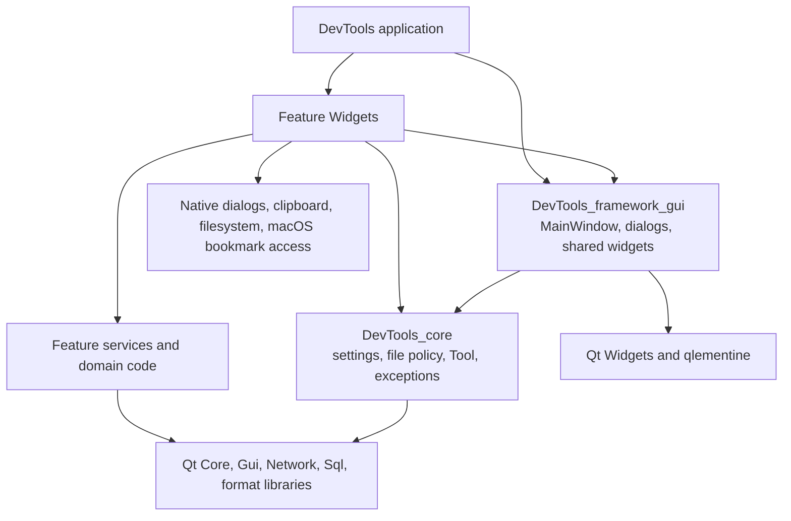

# M1 architecture and responsibility inventory

## Scope and outcome

This inventory covers the shared application shell and all nine product
features: command generation, data conversion, database tools, HTTP requests,
image tools, Markdown preview, phrase generation, QR generation, and regex
testing. Processing is called through non-Widget services or domain classes;
the UI owns input collection, presentation, localization, native dialogs,
clipboard access, and view state.

The source audit found no `QWidget`, `QDialog`, `QMessageBox`, or feature GUI
include in `features/**/core`. `DevTools_core` now contains shared non-UI code
and links Qt Core only. Shared widgets live in
`DevTools_framework_gui`, which depends on `DevTools_core`. Feature widgets
call their feature services and the shared GUI layer; the reverse source
dependency is absent.

The feature CMake libraries still aggregate `core/` and `gui/` sources and
share a broad Qt link interface for compatibility. This is a target-granularity
limitation, not a source dependency from core into widgets. Dedicated service
tests compile with `CORE_ONLY` and link the minimum required Qt modules; see
the verification record for the inspected targets.

## Feature responsibility inventory

| Feature | UI responsibility | Non-Widget processing boundary | Focused tests |
| --- | --- | --- | --- |
| Shared framework | Window lifecycle, shared controls, dialogs, localized display | `ApplicationSettingsService` owns shared settings and geometry; `LocalFileSelectionService` validates suffixes and selects existing local files; `Tool`, exceptions and `ApplicationMixin` remain in Core | `test_application_settings_service`, `test_local_file_selection_service`, `test_settings_dialog` |
| Command | Category/function/option selection, error dialog, clipboard | `CommandService` returns command text and stable selection/value error codes | `test_command_service`, `test_command` |
| Data conversion | Format and indentation controls, editor, file dialogs, clipboard and messages | `DataConversion` owns detection, parse/emit, file load/save and conversion results | parser/emitter tests, `test_data_conversion`, `test_data_conversion_gui` |
| Database | Connection dialogs and password prompt, table/query views, translated SQL errors | `DatabaseConnection`, `SQLitePaths`, `SQLiteFileAccess`, `SQLiteAccessRestore`, `ConnectionHistory`, `QueryService`, and `DatabaseBrowseService` own connection/path/history/query/table operations | `test_database_connection`, `test_connection_history`, `test_query_service`, `test_database_browse_service`, database Widget regressions |
| HTTP | Request form, response/status/error rendering | `HttpService` owns request construction, transport, IDs, cancellation and response DTOs | `test_http_service`, `test_api_tool` |
| Image | Image selection, controls, preview, scaling, status dialogs | `ImageProcessingService` owns load/save, transformations, transparency, split output and image-file validation; `ImageIO` and `BasicImageEditInterface` retain their existing image-domain roles | `test_image_processing_service`, image Widget regressions |
| Markdown | Editor/browser, file dialogs, debounce, scroll synchronization | `MarkdownService` owns UTF-8 file I/O, GitHub-dialect rendering and HTML export | `test_markdown_preview`, `test_markdown_preview_gui` |
| Phrase generation | Template list/editor, confirmation, validation message, clipboard | `TemplateReader` and `TemplateRepository` own list/load/validate/save/delete and dirty comparison | `test_template_reader`, `test_template_repository`, `test_phrase_generation_gui` |
| QR | Field widgets, validation message translation, preview, clipboard and save dialog | `QRValidation`, `ContentGenerator`, and `QRImage` own field validation, payload construction, image generation and PNG writing | `test_qr_service`, `test_qr_gui` |
| Regex | Input controls, 100 ms debounce, highlighting, display, clipboard and localized timeout/error text | `RegexSettingsRepository`, `RegexTool`, `RegexWorker`, and `RegexEvaluationService` own settings, option mapping, match/replace, request lifecycle and timeout | `test_regex_settings_repository`, `test_regex_worker`, `test_regex_evaluation_service`, `test_regex_tool` |

The per-feature records contain detailed input/output compatibility notes and
known limits: [command](m1-command-service.md),
[data conversion](m1-data-conversion.md), [database connection](m1-db-connection.md),
[database query/history](m1-db-query-history.md), [database browsing](m1-database-browse.md),
[HTTP](m1-http-service.md), [image](m1-image-processing.md),
[Markdown](m1-markdown-service.md), [phrase templates](m1-template-repository.md),
[QR](m1-qr.md), [regex settings](m1-regex-settings.md), and
[regex evaluation](m1-regex-evaluation-service.md).

## Custom UI class inventory

This list includes project-owned classes deriving from Qt widget/application
or presentation bases in production source. Test fixtures are excluded.

| Area | Classes |
| --- | --- |
| Shared shell | `GuiApplication`, `MainWindow`, `ContentsArea`, `Sidemenu`, `SidemenuItem`, `WelcomePage`, `SettingsDialog`, `AboutDevToolsDialog`, `GuiTool`, `_GuiToolSuperClass` |
| Shared design helpers | `QlementineTextBrowser`, `RoundedListItemDelegate`, `RoundedListStyle` |
| Command | `Command` |
| Data conversion | `DataConversionGUI` |
| Database | `ConnectionSelector`, `ConnectionWindow`, `dbMain`, `QueryPage` |
| HTTP | `api_tool` |
| Image | `ImageToolsUnifiedGUI`, `BasicImageView`, `BasicImageViewControl`, `ImageOpenDialog`, `ImageSaveDialog`, `ColorSample`, `ImageViewForImageTransparent`, `ClickableLabel` |
| Markdown | `MarkdownPreviewGUI` |
| Phrase generation | `phraseGeneration` |
| QR | `QRCodeGenerationGUI` |
| Regex | `RegexTesterGUI`, `RegexHighlighter` |

## Async lifecycle audit

| Flow | Start and result | Error, timeout, cancellation and stale results | Ownership and cleanup |
| --- | --- | --- | --- |
| HTTP | `HttpService::send` returns a request ID; completion emits an `HttpResponse` with bytes, status, error fields and elapsed time | Qt network errors flow through the response. `cancel(id)` aborts only the matching reply. The UI intentionally displays each completion in completion order, even if a newer request completed earlier. No application timeout policy is configured; Qt defaults remain in effect. | `QNetworkAccessManager` is parented to the service and replies are deleted after completion. Service and manager remain on the creating thread. |
| Regex | `RegexEvaluationService::evaluate` issues a monotonically increasing ID; only the current ID emits a result | A new request interrupts the active worker; `cancel()` invalidates the ID. The 500 ms watchdog invalidates the ID, interrupts work and emits a timeout event. Stale worker notifications are discarded. | The service tracks superseded workers as well as the active worker. On destruction it disconnects, interrupts, waits for and deletes each worker. Each completed worker is removed and deferred-deleted on the service thread. |

Database connections and query models are synchronous and thread-affine; they
must be used and released on their Qt SQL owning thread. No worker-thread or
dialog object is passed into Core. User-facing dialogs are raised by the
Widgets after they receive an error/result value.

## Proposed Bridge input/output contracts

These are value-oriented proposals for a future host boundary. No Bridge,
WebEngine, Tauri, or Rust integration is part of M1.

| Capability | Proposed input | Proposed output and rules |
| --- | --- | --- |
| Shared settings | `{theme, locale, mainWindowGeometry}` | `{success, error}`; preserve existing QSettings keys/defaults and encoded geometry. |
| File selection policy | `{urls, suffixes}` or `{path, acceptedFormats}` | `{path, accepted, errorCode}`; only local existing files; native permissions and bookmark lifetime stay with the host. |
| Command generation | `{category, functionIndex, optionIndex, value}` | `{command, errorCode}`; keep localized descriptive labels at the host boundary. |
| Data conversion | `{input, outputFormat, indentation}` and path-based load/save requests | `{output, messages, success, error}`; preserve parser detection order, encoding, overwrite behavior and stable formats. |
| Database | `{connectionId, parameters}`, `{connectionId, sql}`, `{connectionId, tableName, page, pageSize}` | `{connectionId, status/error}`, `{columns, rows, error}`, `{tables, error}`; never serialize a live `QSqlDatabase`, `QSqlQuery`, or model. Define NULL/binary/type and row-order semantics. |
| HTTP | `{requestId, method, url, headers, credentials, body, timeoutMs?}` | `{requestId, status, reason, headers, body, errorCode, error, elapsedMs}`; define host timeout, cancellation acknowledgement, body limits and credential redaction before exposing it. |
| Image | `{imageHandle, operation, options}` or a host-approved path | `{imageHandle, width, height, success, error}`; use handles or binary transfer for large images rather than JSON/base64 copies. |
| Markdown | `{source}` or `{path, source}` | `{html}`, `{source, error}`, or `{success, error}`; native path picking and external-link opening stay in the host. |
| Phrase templates | `{id?, title, content}` and `{id}` for load/delete | `{templates}`, `{id, title, content}`, `{success, errorCode}`; host confirms destructive actions and constrains template IDs to the content directory. |
| QR | `{type, parameters}` | `{payload, imageHandle, validationErrors:[{field, code}], error}`; translate stable validation codes in the host. |
| Regex | `{requestId, pattern, text, replacement, flags, global, timeoutMs}` | `{requestId, matches, captures, replacedText, valid, error, timedOut}`; `cancel({requestId})` invalidates older results. Bound input size and explicitly document that interruption cannot stop an in-progress Qt regex call. |

The current C++ service interfaces use Qt value types (`QString`, `QImage`,
`QSqlError`, `QJsonObject`, and Qt containers). A Bridge must define explicit
serialization, size limits, stable error codes and ownership of file/database
handles before wrapping those APIs.

## Rust candidates and Qt boundaries

Good candidates for isolated Rust implementations after contracts exist:

- Command selection validation and deterministic command-string generation.
- Stable DTO validation, mapping and serialization for settings, regex results,
  database rows and QR validation codes.
- Template input validation and dirty comparison.
- Data-conversion workflow coordination, if parser/emitter output and error
  parity are defined for each format.

Keep these behind Qt/native adapters unless compatibility is established:

- Qt SQL drivers, `QSqlDatabase`, query result models, and macOS
  security-scoped SQLite bookmarks (`Foundation`).
- Qt Network manager/reply behavior, Qt regular-expression syntax/capture and
  replacement behavior, and the Qt Markdown parser/HTML serialization.
- `QImage`, Qt image-format plugins, and `QPixmap` presentation.
- Existing QSettings persistence, native file dialogs, clipboard and Qt
  resource display.
- YAML/TOML/JSON parser behavior and Qt Core file/text stream encoding.

## Residual dependencies and limits

- The shared `DevTools_core` target links Qt Core only. It does not link Qt
  Gui or Qt Widgets.
- `DevTools_framework_gui` links Qt Core, Gui, Widgets and qlementine and
  depends on `DevTools_core`.
- Existing feature targets still link a broad set of Qt Core, DBus, Gui,
  Widgets, Network and SQL modules. A later CMake cleanup could split every
  feature archive into separate Core and GUI targets; source-level direction
  is already one-way and core-only tests do not need Widgets.
- HTTP has request IDs and cancellation but no application-configured timeout;
  Qt defaults are retained. Its existing shared elapsed-time field reports
  overlapping requests relative to the most recently started request.
- Regex cancellation is cooperative and cannot interrupt a single
  catastrophic-backtracking regex call until Qt returns control.
- Database behavior was verified with SQLite only. Other SQL drivers,
  signed-app security-scoped bookmarks, and connection replacement while
  models are active need platform/integration verification.
- Template replacement preserves existing delete-before-write behavior.
  Changing that persistence contract is a separate data-safety change.
- No manual visual regression, non-macOS run, WebEngine/Tauri port, or Rust
  port was performed for M1.

## Remaining work outside M1

- Split each mixed feature archive into separate Core and GUI CMake targets if
  target-level dependency enforcement is needed; the source-level direction
  and service test boundaries are already established.
- Define and implement a concrete host Bridge only when a WebEngine or Tauri
  integration is approved. The DTO contracts above are proposals, not a
  shipped protocol.
- Run manual visual checks, signed-app bookmark tests, additional SQL drivers,
  and non-macOS builds in their target environments.
- Review the documented HTTP overlapping-request elapsed-time defect and
  template delete-before-write behavior as separate compatibility/data-safety
  changes.
