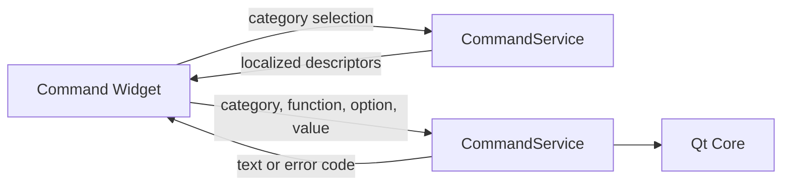

# M1 command generation service

## Scope and responsibility

The Git, Docker, and Docker Compose command catalog, option metadata, quote
validation, and command assembly now live in `features/command/core/`. The
Widget retains category/function/option selection, visibility and focus state,
translated error dialogs, clipboard access, and displaying the generated text.
The generated commands are displayed as text and are never executed.

The service exposes `CommandService::functions(category)` and
`CommandService::generate(category, functionIndex, optionIndex, value)`. The
result is command text or a stable `CommandGenerationError`; no dialog or
Widget pointer crosses the service boundary. Catalog descriptions continue to
use the existing Qt translation context `Command`, so the existing English and
Japanese strings remain available.

## Compatibility and Bridge proposal

The catalog sizes remain 7 Git commands, 13 Docker commands, and 10 Docker
Compose commands. The current command strings, option order, value spacing,
double quoting for the commit message, and rejection of values containing any
single quote, double quote, or backtick are unchanged. Empty values remain
allowed and are appended under the same required-option rules as before. The
service does not invoke a shell and performs no new escaping or normalization.

A future Bridge can expose the catalog using stable category/function/option
IDs and localized labels, then accept
`generateCommand({categoryId, functionId, optionId, value})` and return either
`{command}` or `{errorCode}`. The current C++ UI still selects catalog entries
by index; the Bridge should not use translated display text as an identifier.
No Bridge or Rust implementation is part of M1.

The headless service test links Qt Core and Qt Test only. The feature module
still links Widgets for presentation. There is no dependency from the command
service to `QWidget`, dialogs, or clipboard APIs. Catalog strings use Qt Core's
translation lookup with the original `Command` context.

## Verification and limits

Environment: macOS 26.6.2 arm64, Homebrew Qt 6.9.2, existing `build` directory
with `ENABLE_UNIT_TEST=ON`.

- `cmake --build build --target format`: passed.
- `cmake --build build --target test_command_service test_command
  DevTools_command -j 8`: passed.
- `QT_QPA_PLATFORM=offscreen ctest --test-dir build -R
  '^test_command(_service)?$' --output-on-failure`: 2/2 passed. The service
  test covers all three catalog sizes, Git/Docker generation, optional and
  required options, quoting, invalid values and invalid selections. The
  existing Widget test verifies the Git catalog still reaches generated UI
  output.
- `otool -L build/test_command_service`: Qt Core and Qt Test only; no Qt Gui or
  Qt Widgets.
- `res/dev-tools_ja_JP.ts` retains the `Command` context and its existing
  translations for catalog labels such as `Add changes` and `None`. No
  translation source string changed, so the translation catalog was not
  regenerated.
- Compared the catalog source before and after extraction: all 67 translated
  label calls remain present under the same context, with no missing or added
  source strings.
- No manual visual review, shell execution, or second-OS check was performed.

After this extraction, `cmake --build build -j 8` built all application and
test targets. `cmake --build build --target format-check` and `git diff
--check` passed. Full `ctest --test-dir build --output-on-failure` passed 41/42;
the only failure was the already-known DB connection test comparing `/var/...`
with `/private/var/...`. That test passed individually with
`TMPDIR=/private/tmp QT_QPA_PLATFORM=offscreen`. The build also reported the
two existing `nodiscard` warnings in
`features/data_conversion/tests/emitter/test_basic_emitter.cpp`; the changed
Command service produced no compiler warnings.

This slice does not complete Issue #132. The image editor still performs image
operations in its Widget, and remaining file, database, feature, and shared
application responsibilities still require a complete audit and extraction.

## Execution record

At 2026-10-27 18:05 JST, the goal runtime reported 2,055 seconds. It includes
work and waits across slices and is not model execution time. Human
intervention and per-command Codex execution time were not independently
measured. The commit is recorded in Git history; no PR or issue state change
was made.
