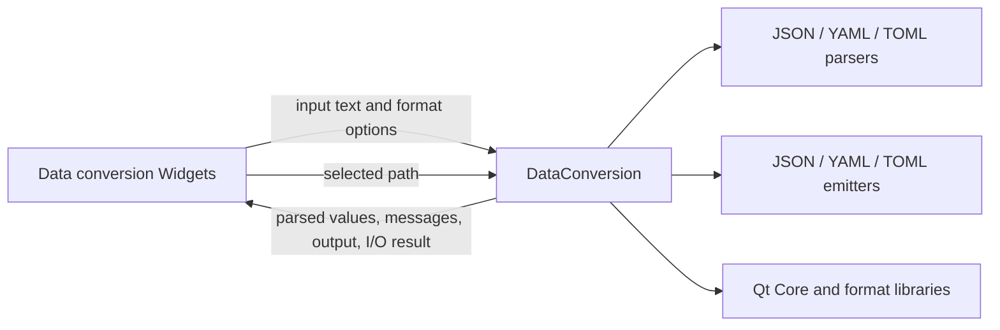

# M1 data conversion service integration

## Scope and responsibility

`DataConversion` already owns format detection, parsing, serialization,
formatting, file loading, and file saving in the Widgets-free core module. The
GUI previously bypassed its file APIs and read or wrote files directly. File
selection remains in `DataConversionGUI`; after selection, it now calls
`DataConversionInterface::load` or `save` and only copies service data into
the editor.

The service remains the application boundary: it receives text, output format,
indentation, or a file path and exposes converted text, messages, and a success
value. The widget retains the file dialogs, clipboard, editors, format and
indentation selectors, and message display.

## Compatibility and Bridge proposal

File load keeps the existing text decoding behavior and feeds the loaded text
through the same editor change path. Save uses `save(path, true)` to retain the
existing Save dialog's overwrite behavior. JSON, TOML, and YAML detection order,
format choices, indentation, empty-input handling, and current error and warning
messages are unchanged. File errors remain silent in the UI, as before.

A future Bridge can expose
`convert({input, outputFormat, indentation}) -> {output, messages}` and
`loadText({path})` / `saveText({path, text, overwrite}) -> {success, error}`.
Qt WebEngine may pass selected paths from the native host. Tauri should receive
the same request and result shape while delegating file access to an approved
host capability. The existing parser/emitter libraries are current behavior
dependencies; a Rust rewrite would need output and error compatibility checks
before replacing them.

Rust candidates include format selection, pipeline coordination, and stable
error/result DTOs. Qt Core file access and text handling, Qt JSON parsing, and
the current YAML/TOML libraries remain C++/host boundaries until equivalence is
established. The UI still runs conversion synchronously on text changes; the
existing one-megabyte input responsiveness concern remains outside this
extraction.

## Verification and limits

Environment: macOS 26.6.2 arm64, Homebrew Qt 6.9.2, existing `build` directory
with `ENABLE_UNIT_TEST=ON`.

- `cmake --build build --target format`: passed.
- `cmake --build build --target test_data_conversion
  test_data_conversion_gui DevTools_data_conversion -j 8`: passed.
- `QT_QPA_PLATFORM=offscreen ctest --test-dir build -R
  '^test_data_conversion(_gui)?$' --output-on-failure`: 2/2 passed. The
  existing core test covers parser/emitter and load/save behavior; the new
  Widget regression loads a JSON file through the GUI-selected path, confirms
  converted output appears, and saves that output through the service.
- Source inspection confirms `data_conversion_gui.cpp` no longer includes or
  calls `QFile` or `QTextStream`.
- No manual visual review or other-OS verification was performed.

This integration closes the GUI's direct file-I/O bypass. It does not complete
Issue #132; the remaining tools, shared application classes, aggregate
dependency inventory, and lifecycle review still need to be completed.

## Execution record

At 2026-10-27 18:20 JST, the Issue #132 goal runtime was 2,971 seconds. Runtime
includes work and waits across the task, not model execution time. Human
intervention and per-command Codex execution time were not independently
measured. No PR or issue state change was made.
