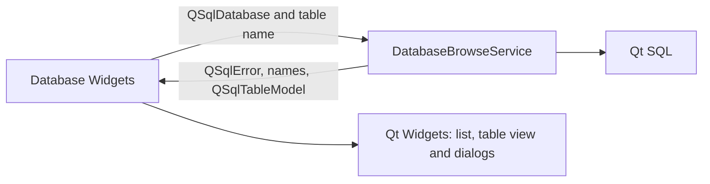

# M1 database browsing service

## Scope and responsibility

`DatabaseBrowseService` now owns the SQLite validation query, SQL table-name
lookup, and initialization of a `QSqlTableModel`. `dbMain` retains the
connection lifecycle, table-list and table-view Widgets, user-facing error
dialog, and model refresh when the user switches tables.

The service has no Widget dependency. The headless service test links Qt Core,
Qt SQL and Qt Test; its binary does not link Qt Widgets. The model is still a
Qt SQL model, so the caller must keep the connection open and use it on the
connection's owning thread for the model's lifetime.

## Compatibility and Bridge proposal

SQLite validation executes the same `SELECT name FROM sqlite_master WHERE
type='table' LIMIT 1;` query and returns the original `QSqlError`. Table names
still come from `QSqlDatabase::tables(QSql::Tables)`. Model creation keeps the
existing `QSqlTableModel`, table name and immediate `select()` behavior. No
driver, SQL statement, sorting, error dialog, or table-refresh behavior changed.

A future Bridge can expose `validateDatabase({connectionId})`,
`listTables({connectionId}) -> {tables}`, and
`readTable({connectionId, tableName, page, pageSize}) -> {columns, rows,
nextPage, error}`. It should use stable connection handles and bounded pages;
it should not attempt to serialize a live `QSqlTableModel`. Driver errors,
NULLs, binary cells, type information, row ordering, and connection closure
need an explicit cross-platform contract.

Rust candidates include request validation and DTOs for table/row values. Qt
SQL drivers and `QSqlTableModel` currently own the driver behavior and live
model semantics. Replacing those parts would require matching driver coverage,
table ordering, type conversion, and incremental updates, so they remain behind
the service for now.

## Verification and limits

Environment: macOS 26.6.2 arm64, Homebrew Qt 6.9.2, existing `build` directory
with `ENABLE_UNIT_TEST=ON`.

- `cmake --build build --target test_database_browse_service
  test_db_main_connection`: passed.
- `QT_QPA_PLATFORM=offscreen ctest --test-dir build -R
  '^test_database_browse_service$' --output-on-failure`: 1/1 passed. The
  headless test covers validation of an open in-memory SQLite database, table
  listing, and selected table data from the initialized model.
- `QT_QPA_PLATFORM=offscreen ctest --test-dir build -R
  '^test_db_main_connection$' --output-on-failure`: 1/1 passed.
- `otool -L build/test_database_browse_service`: Qt Core, SQL and Test; no Qt
  Widgets.
- `cmake --build build --target format-check` and `git diff --check`: passed.
- SQLite is the only tested driver. MySQL/PostgreSQL behavior, sorting,
  concurrent connection closure, and manual visual review were not tested.

This slice moves table browsing operations out of the Widget. Settings and
shared-shell services, the remaining feature audit, aggregate class/dependency
inventory, and lifecycle review remain for Issue #132.

## Execution record

At 2026-10-27 18:32 JST, the Issue #132 goal runtime was 3,678 seconds. Runtime
includes work and waits across the task, not model execution time. Human
intervention and per-command Codex execution time were not independently
measured. No PR or issue state change was made.
