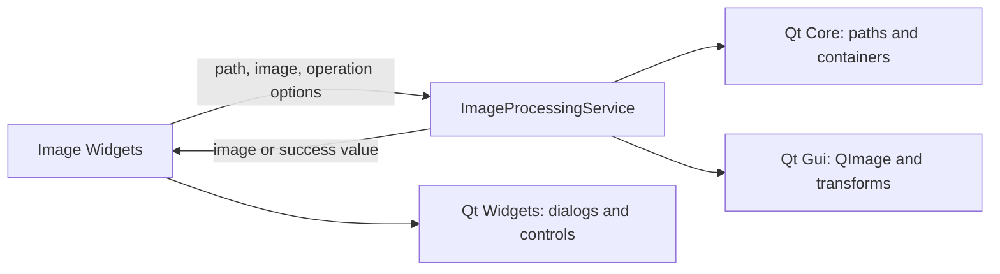

# M1 image processing service

## Scope and responsibility

Image file loading and saving, pixel-format normalization, resize, rotation,
flips, transparency matching and flood fill, and divided-image generation now
live in `features/image/core/image_processing_service.*`. The unified image
Widget owns dialogs, control state, preview updates, and user-facing errors.
The service depends on Qt Core and Qt Gui (`QImage`), with no Qt Widgets
dependency.

The service contract accepts images and values rather than widget pointers. Its
API covers load/save, resize by target dimensions or scale, rotate and flip,
transparency-to-alpha conversion and application, and image splitting to a
chosen folder. Folder selection and result dialogs remain in the UI.

## Compatibility and Bridge proposal

The extraction retains the existing RGBA8888 load format, scaling quality
choice, aspect-ratio calculation, 90-degree transforms, alpha calculation,
RGB/HSV/HSL color distance, four-neighbor contiguous flood fill, split naming,
cell sizing and remainder rules. Pixel-level transparency processing still
uses Qt `QColor` and `QImage`. Invalid or empty operations retain their prior
no-op/error behavior where that behavior existed in the Widget.

A future Bridge can accept a serialized operation request such as
`resizeImage({imageBytes, width, height, keepAspectRatio, smooth})`,
`makeTransparent({imageBytes, point, color, mode, tolerance, opacity, contiguous})`,
or `splitImage({imageBytes, sourceName, folder, options})`. Results should be
image bytes plus dimensions or a stable error code. File dialogs remain a host
capability; path access should be explicitly granted to the Bridge. No Bridge
or Rust implementation is part of M1.

Rust migration candidates include resize parameter calculation, flip/rotation
geometry, color-distance and flood-fill rules, and split rectangle planning.
`QImage` loading, format conversion, scaling interpolation, PNG/JPEG codecs,
and Qt color-space conversions are Qt-specific boundaries and should remain
host adapters unless replaced with a separately selected image library.

## Verification and limits

Environment: macOS 26.6.2 arm64, Homebrew Qt 6.9.2, existing `build` directory
with `ENABLE_UNIT_TEST=ON`.

- `cmake --build build --target format`: passed.
- `cmake --build build --target test_image_processing_service
  test_image_processing_gui -j 8`: passed.
- `QT_QPA_PLATFORM=offscreen ctest --test-dir build -R
  '^test_image_processing_(service|gui)$' --output-on-failure`: 2/2 passed.
  The Qt Widgets-free service test covers load/save, format and pixels, resize
  and aspect-ratio edge cases, scale, flips, rotation, RGB/HSV/HSL transparency,
  contiguous flood fill, and split naming/remainders/failures. The UI regression
  test loads an image through the Widget, rotates it, checks the displayed size,
  and saves the resulting image.
- `otool -L build/test_image_processing_service`: Qt Core, Gui and Test; no Qt
  Widgets.
- `cmake --build build -j 8`: all application and registered test targets
  built successfully.
- `cmake --build build --target format-check` and `git diff --check`: passed.
- Default-path full CTest run passed 43/44; the existing DB connection-window
  assertions compared `/var/...` with the same temporary directory's
  `/private/var/...` spelling. The full suite passed 44/44 with
  `TMPDIR=/private/tmp QT_QPA_PLATFORM=offscreen`; localhost HTTP integration
  tests required local socket access because the sandbox denied server binds.
- The tests use Qt's offscreen platform. No manual visual review, native file
  dialog interaction, other-OS run, or codec interoperability test was done.

This extraction does not complete Issue #132. The whole-repository audit,
remaining feature and shared-application processing, cross-feature lifecycle
checks, and complete dependency and migration inventory remain outstanding.

## Execution record

At 2026-10-27 18:16 JST, the Issue #132 goal runtime was 2,746 seconds. This
includes work and waits across all slices, not model execution time. Human
intervention and per-command Codex execution time were not independently
measured. No PR or issue state change was made.
