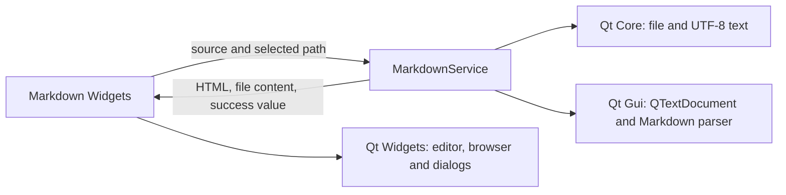

# M1 Markdown service

## Scope and responsibility

`MarkdownService` owns UTF-8 file loading and saving, GitHub-flavored Markdown
to HTML conversion, and HTML export. `MarkdownPreviewGUI` calls the service for
open, save, export, and each debounced preview render. The Widget retains file
dialogs, editor and browser widgets, the 180 ms debounce timer, and optional
scroll synchronization.

`MarkdownService` has no `Tool` or Widget dependency. The separate
`MarkdownPreview` object only supplies the existing tool identity and lifetime.
The UI-free service test links Qt Core, Qt Gui and Qt Test and does not link Qt
Widgets.

## Compatibility and Bridge proposal

The service uses `QTextDocument::MarkdownDialectGitHub`, UTF-8 file streams,
and the existing Qt HTML serialization. HTML export and live preview now share
the same conversion method. The UI still renders synchronously after its
existing debounce, opens external links, adds `.md` or `.html` when the chosen
filename has no extension, and shows the same file failure dialogs.

A future Bridge can expose `renderMarkdown({source}) -> {html}`,
`readMarkdown({path}) -> {source, error}`,
`writeMarkdown({path, source}) -> {success, error}`, and
`exportMarkdownHtml({path, source}) -> {success, error}`. Native path selection
and external-link opening remain host capabilities. Qt WebEngine and Tauri can
share these value-based operations without sending Widget references.

Rust candidates include request validation, file-operation result DTOs, and
coordination. The Markdown parser and HTML serialization are currently Qt Gui
behavior; replacing them with another engine could change dialect support,
escaping, links, tables, and generated markup, so they remain behind the service
until output compatibility is verified.

## Verification and limits

Environment: macOS 26.6.2 arm64, Homebrew Qt 6.9.2, existing `build` directory
with `ENABLE_UNIT_TEST=ON`.

- `cmake --build build --target format`: passed.
- `cmake --build build --target test_markdown_preview
  test_markdown_preview_gui DevTools_markdown_preview -j 8`: passed.
- `QT_QPA_PLATFORM=offscreen ctest --test-dir build -R
  '^test_markdown_preview(_gui)?$' --output-on-failure`: 2/2 passed. The core
  test covers UTF-8 file I/O, missing-file behavior, HTML conversion, and
  export. The Widget regression confirms text and Markdown rendering match a
  direct GitHub-dialect `QTextDocument` parse.
- `otool -L build/test_markdown_preview`: Qt Core, Gui and Test; no Qt Widgets.
- `cmake --build build --target format-check` and `git diff --check`: passed.
- The UI regression uses Qt's offscreen platform. No manual visual review,
  external-link click, file-dialog interaction, or other-OS check was done.

This slice moves the live preview parser call out of the Widget. Other feature
processing, shared application classes, aggregate dependency inventory, and
lifecycle review remain for Issue #132.

## Execution record

At 2026-10-27 18:28 JST, the Issue #132 goal runtime was 3,480 seconds. Runtime
includes work and waits across the task, not model execution time. Human
intervention and per-command Codex execution time were not independently
measured. No PR or issue state change was made.
