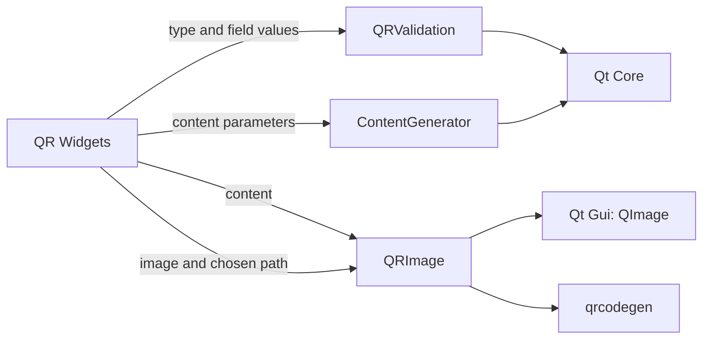

# M1 QR code services

## Scope and responsibility

This slice moves QR validation, content readiness, QR raster generation, and
PNG file writing out of `QRCodeGenerationGUI`. The widget still owns form
construction, the native save dialog, translated validation messages, preview
scaling, clipboard access, and success/error dialogs. `qrcodegen` remains
unchanged bundled code.

The new headless-facing APIs are:

- `QRValidation::canGenerate(type, fields)` decides whether the UI enables the
  Generate button. It intentionally preserves the prior distinction between
  button readiness and full validation (for example, a nonempty malformed URL
  can be submitted and then receives a validation error).
- `QRValidation::validate(type, fields)` returns field keys and stable error
  codes. The widget maps these to the existing `tr()` strings and labels.
- `QRImage::generate(content)` returns the same 8-pixel-per-module RGB32 image
  produced by the old widget code. `QRImage::savePng(image, path)` owns PNG
  encoding and file writing; destination selection and user feedback remain in
  the widget.
- `ContentGenerator` continues to compose the existing text, URL, email,
  telephone, SMS, Wi-Fi, vCard, iCalendar, and geo payload strings.

## Compatibility and Bridge proposal

Validation logic is UI-independent and returns machine-readable codes rather
than translated strings. A future Bridge can expose calls equivalent to
`validateQr({type, fields}) -> {errors: [{field, code}]}` and
`generateQr({type, fields}) -> {content, pngBytes}`. Native file selection can
remain a host capability; the Bridge should pass the selected destination to
`QRImage::savePng` and return a structured success/error result. No Bridge or
Rust implementation is part of M1.

Legacy behavior retained by this extraction includes case-sensitive URL
prefix checking, the existing email and phone checks, current calendar
validation, the current content formats, and the current Wi-Fi serialization
(including `P:` for an empty password and not serializing the hidden-network
checkbox). Content escaping and those format choices were not changed. Such
behavior may need later compatibility review before changing it.

Qt dependencies are Qt Core (`QString`, `QVariantMap` and error data) and Qt
Gui (`QImage` and PNG encoding). The headless service test links Core, Gui and
Test, and has no Widgets dependency. The image module is a data-processing
dependency expressly permitted by Issue #132; it is not evidence of a UI
dependency. Future Rust candidates are `QRValidation`, `ContentGenerator`, and
the QR encoding pipeline, subject to preserving the recorded outputs and
error behavior. PNG encoding and file writing now sit behind a Qt Gui service;
native path selection remains a host capability.

## Verification and limits

Environment: macOS 26.6.2 arm64, Homebrew Qt 6.9.2, existing `build` directory
with `ENABLE_UNIT_TEST=ON`.

- `cmake --build build --target format`: passed after the changes.
- `cmake --build build --target test_qr_service test_qr_gui
  DevTools_qr_code_generation -j 8`: passed.
- `QT_QPA_PLATFORM=offscreen ctest --test-dir build -R
  '^test_qr_(service|gui)$' --output-on-failure`: 2/2 passed. The headless test
  covers validation and payloads for all nine types, PNG write/read and a
  failed write, capacity failure, ASCII/Unicode QR image dimensions and
  pre-extraction pixel hashes. The Widget test exercises all nine categories,
  validation display, button readiness, content output, preview, and generated
  image display.
- Before changing the widget renderer, independently captured the old
  generator's RGB32 pixel hashes for `hello` and `日本語`; both are fixed in
  `test_qr_service`. The image is 168 x 168 for these inputs. Hashes depend on
  the platform's in-memory QImage byte order and are therefore a regression
  check on this macOS arm64 configuration, not a cross-platform file-format
  fingerprint.
- `otool -L build/test_qr_service`: Qt Core, Gui and Test; no Qt Widgets.
- No QR scanner decode/interoperability test, other OS run, manual visual
  review, native save-dialog interaction, or signed distribution check was
  performed. The Widget test uses Qt's offscreen platform.
- `cmake --build build -j 8`: passed after the PNG-save extraction.
- `cmake --build build --target format-check` and `git diff --check`: passed
  after the changes.
- `ctest --test-dir build --output-on-failure`: 40/41 passed. The remaining
  failure is the pre-existing `test_db_connection_window` path spelling
  assertion (`/var/...` versus `/private/var/...`). It passes when rerun with
  `TMPDIR=/private/tmp QT_QPA_PLATFORM=offscreen`, which yields a canonical
  temporary path matching the assertion. No test was disabled or weakened.

This extraction completes only QR processing boundaries. Issue #132 still
requires auditing and extracting remaining feature and shared application
processing, documenting the complete dependency and class inventory, and
verifying the full application lifecycle and integration behavior.

## Execution record

At 2026-10-27 17:56 JST, the goal runtime reported 1,545 seconds. Runtime
includes work and waits and is not model execution time. Human intervention
and per-command Codex execution time were not independently measured. No PR or
issue state change was made.
