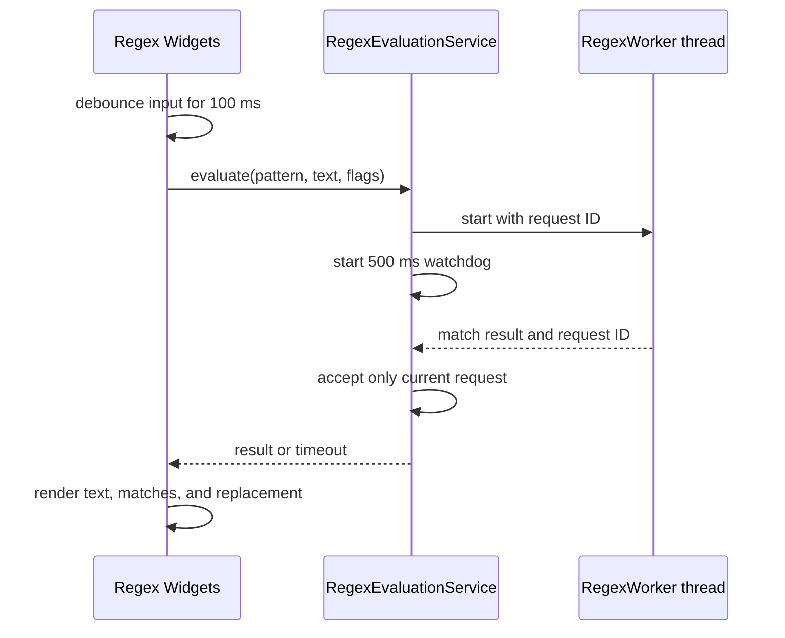

# M1 regex evaluation service

## Scope and responsibility

`RegexEvaluationService` now owns `RegexWorker` creation, interruption,
request IDs, stale-result rejection, the 500 ms watchdog, timeout events, and
worker cleanup. It tracks all workers so shutdown can disconnect and interrupt
workers that were superseded as well as the current worker. Workers have no
service parent and schedule their own deletion after finishing, so service
destruction does not block while a regex engine call completes. `RegexTesterGUI`
retains the 100 ms input debounce, reads the current controls when it expires,
and renders returned results or errors.

The service uses Qt Core (`QObject`, `QTimer`, `QThread`) and the existing Qt
regular-expression engine. Workers are independent QThread objects; the service
disconnects and interrupts them during teardown, and each worker schedules its
own deletion when its thread finishes. The service is parented to the Widget,
so its teardown returns without joining regex workers. Its test target links Qt
Core and Qt Test without Qt Widgets.

## Compatibility and Bridge proposal

The GUI still waits 100 ms after input changes before taking the latest
pattern, source text, replacement, flags, and global option. Each started
evaluation receives a monotonically increasing request ID. A new evaluation
interrupts the previous worker; only the newest request can publish a result.
The watchdog still starts after the worker starts and expires after 500 ms.
Timeout invalidates the current ID, requests interruption, and leaves the
existing result-display behavior to the Widget. Closing the Widget disconnects
and interrupts every tracked worker, including superseded workers. A worker
already inside a Qt regex call finishes that call before observing interruption;
it then exits and schedules its own deletion without sending a result to the
destroyed service.

A future Bridge can expose `evaluateRegex({requestId, pattern, text,
replacement, flags, global, timeoutMs}) -> {requestId, matches, replacedText,
error, timedOut}` and `cancelRegex({requestId}) -> {accepted}`. Results from
older IDs must be ignored. A host must also define cancellation limits for
regex-engine calls that cannot observe thread interruption until a match
operation returns.

Rust candidates include request coordination and serialization of the
`MatchResult` DTO. The QRegularExpression engine and worker thread stay in Qt
until syntax, capture, replacement, cancellation, and timeout compatibility is
defined across implementations.

## Verification and limits

Environment: macOS 26.6.2 arm64, Homebrew Qt 6.9.2, existing `build` directory
with `ENABLE_UNIT_TEST=ON`.

- `cmake --build build --target test_regex_evaluation_service
  test_regex_worker test_regex_tool DevTools`: passed.
- `QT_QPA_PLATFORM=offscreen ctest --test-dir build -R
  '^test_(regex_evaluation_service|regex_settings_repository|regex_worker|regex_tool)$
  --output-on-failure`: 4/4 passed. Tests cover latest-request acceptance,
  stale-result rejection, cancellation, timeout invalidation, non-blocking
  service destruction during an active regex call, matching, replacement,
  capture details, and Widget settings persistence.
- `otool -L build/test_regex_evaluation_service`: Qt Core and Test; no Qt Gui
  or Widgets.
- `cmake --build build --target format-check` and `git diff --check`: passed.
- The zero-millisecond watchdog constructor option is used only to exercise
  the timeout path deterministically; production uses the existing 500 ms.
  Regex interruption remains cooperative until the current engine call returns.
  Catastrophic backtracking performance and other platforms were not tested.

Regex matching and lifecycle coordination are outside Widgets. The remaining
Issue #132 work is the complete class/dependency inventory, final audit, and
full build/test evidence.

## Execution record

At 2026-10-27 19:51 JST, the Issue #132 goal runtime was 4,819 seconds. Runtime
includes work and waits across the task, not model execution time. Human
intervention and per-command Codex execution time were not independently
measured. No PR or issue state change was made.
