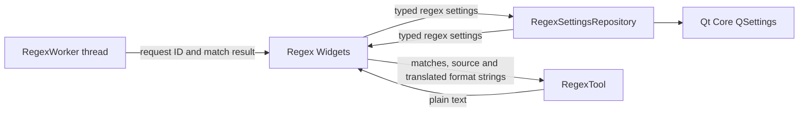

# M1 regex settings and clipboard formatting

## Scope and responsibility

`RegexSettingsRepository` owns the regex tool's persisted input and flag state.
`RegexTool::formatMatchesForClipboard` owns the plain-text copy representation
for a set of matches. `RegexTesterGUI` retains translation lookup, clipboard
access, text fields, timers, highlighter updates, and result widgets.

The repository and formatter use Qt Core only and have no Widget dependency.
Copy text remains localized because the UI supplies the existing translated
format strings. The worker's thread placement, interruption, request IDs,
watchdog timeout, and stale-result handling are unchanged.

## Compatibility and Bridge proposal

The repository keeps the existing `RegexTester/pattern`, `testText`,
`replacePattern`, and `flagG`/`flagI`/`flagM`/`flagS`/`flagU`/`flagX` settings,
including the current defaults and write-without-explicit-sync behavior. Match
clipboard formatting preserves match order, capture-group order, offsets,
Unicode text, final newlines, and the existing localized string templates.

A future Bridge can expose `readRegexSettings() -> {pattern, testText,
replacePattern, flags}`, `saveRegexSettings({…}) -> {success, error}`, and
`formatRegexMatches({matches, source, locale}) -> {text}`. An evaluation
endpoint should preserve request IDs, cancellation, a bounded time budget,
and stale-result rejection. Bridge message size and regex complexity need
explicit limits.

Rust candidates include settings DTOs and clipboard-text formatting. Qt's
`QRegularExpression` remains the regex engine to preserve syntax and matching
behavior. `QThread` remains the current worker mechanism until another host
provides equivalent cancellation, timeout and lifecycle semantics.

## Verification and limits

Environment: macOS 26.6.2 arm64, Homebrew Qt 6.9.2, existing `build` directory
with `ENABLE_UNIT_TEST=ON`.

- `cmake --build build --target test_regex_settings_repository
  test_regex_worker test_regex_tool DevTools`: passed.
- `QT_QPA_PLATFORM=offscreen ctest --test-dir build -R
  '^test_(regex_settings_repository|regex_worker|regex_tool)$
  --output-on-failure`: 3/3 passed. Coverage checks repository defaults,
  exact key persistence and reload, Widget restoration and save, worker output,
  and byte-for-byte clipboard formatting for indexed and named groups.
- `otool -L build/test_regex_settings_repository`: Qt Core and Test; no Qt
  Gui or Widgets.
- `cmake --build build --target format-check` and `git diff --check`: passed.
- The tests do not measure worst-case regular-expression performance or
  clipboard behavior in other desktop environments.

Regex settings and match-copy formatting now use non-Widget code. The
application-wide class/dependency inventory and remaining file/OS boundaries
still need a final audit for Issue #132.

## Execution record

At 2026-10-27 18:41 JST, the Issue #132 goal runtime was 4,246 seconds. Runtime
includes work and waits across the task, not model execution time. Human
intervention and per-command Codex execution time were not independently
measured. No PR or issue state change was made.
