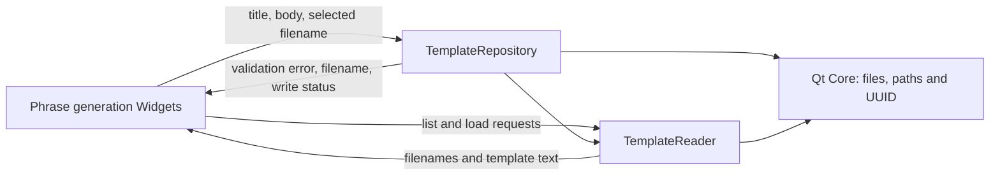

# M1 template repository service

## Scope and responsibility

`TemplateRepository` now owns template input validation, unsaved-change
comparison, creation and replacement, and deletion. `TemplateReader` owns
listing and loading. The phrase-generation Widget keeps controls, confirmation
and error dialogs, list selection, clipboard access, and current screen state.

The service contract is UI-free. Validation returns stable codes for empty
title and empty content. Saving returns the assigned filename and whether the
write completed; removal returns a success value. `hasUnsavedChanges` compares
the supplied editor values with the saved template.

## Compatibility and Bridge proposal

Templates remain `content/*.txt` files relative to the process working
directory and are listed in the same `QDir` order. The first line is the title
and the remaining lines are the content. Saving still assigns a new UUID
filename. Replacing a current template still removes its old file before
attempting the write. The UI still displays the existing validation and delete
failure messages.

For compatibility, the UI does not act on the new `written` result yet. A save
failure therefore still leaves the Widget pointing at the generated filename,
matching its old behavior; this can lose the prior copy during replacement.
The service exposes the failure so a later compatibility-reviewed change can
handle it without changing the storage boundary. `TemplateReader` also retains
its existing unrestricted filename input; a future Bridge must validate IDs
and prevent path traversal before forwarding them.

A future Bridge can expose
`listTemplates() -> [{id, title}]`, `loadTemplate({id}) -> {title, content}`,
`validateTemplate({title, content}) -> {errorCode}`, and
`saveTemplate({id?, title, content}) -> {id, written, errorCode}`. Delete can
return `{success}` after the user confirms in the host UI. The working
directory and template folder should be explicit host configuration rather
than hidden process state. No Bridge or Rust implementation is part of M1.

Rust candidates include input validation, string comparison, and stable
request/result DTOs. Current file ordering, UTF-8 text streams, UUID generation,
and file mutation remain Qt Core or host-infrastructure boundaries until their
behavior is explicitly replaced and checked.

## Verification and limits

Environment: macOS 26.6.2 arm64, Homebrew Qt 6.9.2, existing `build` directory
with `ENABLE_UNIT_TEST=ON`.

- `cmake --build build --target format`: passed.
- `cmake --build build --target test_template_reader
  test_template_repository test_phrase_generation_gui
  DevTools_phrase_generation -j 8`: passed.
- `QT_QPA_PLATFORM=offscreen ctest --test-dir build -R
  '^test_(template_reader|template_repository|phrase_generation_gui)$
  --output-on-failure`: 3/3 passed. Core tests cover reading, filtering,
  validation, dirty comparison, add, update, delete, and failed writes. The
  Widget regression uses an isolated working directory and saves, replaces,
  and reloads a template through the current screen.
- `otool -L build/test_template_repository`: Qt Core and Qt Test only; no Qt
  Widgets.
- `cmake --build build --target format-check` and `git diff --check`: passed.
- No manual dialog, clipboard, permission-denied UI, or other-OS check was
  performed.

This slice moves remaining phrase-template persistence and validation out of
the Widget. Other feature operations, the shared application shell, aggregate
dependency inventory, and app lifecycle review remain for Issue #132.

## Execution record

At 2026-10-27 18:25 JST, the Issue #132 goal runtime was 3,252 seconds. Runtime
includes work and waits across the task, not model execution time. Human
intervention and per-command Codex execution time were not independently
measured. No PR or issue state change was made.
