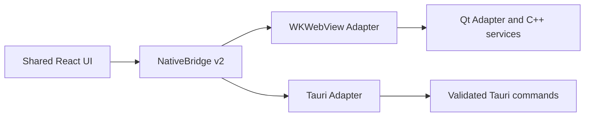

# M4 Tauri migration evaluation

## Scope

This is a Tauri 2 proof of the existing React UI and NativeBridge v2 contract,
not the M5 migration of every native operation. The Tauri window loads the same
`frontend/` build as Qt. Runtime selection stays in
`frontend/src/platform/create-native-bridge.ts`.



The Tauri adapter preserves request IDs and the started/progress/terminal event
shape. Rust checks the contract version, request ID, serialized message limit,
operation, and operation-specific values before running work off the webview
thread. It accepts the existing 1 MiB value limit and 2 MiB message limit, and
caps formatted JSON output at 4 MiB. Only operations in
`src-tauri/src/lib.rs`'s `SUPPORTED_OPERATIONS` list are available; the others
return `UNSUPPORTED_OPERATION` so partial coverage stays visible to the UI.

The implementation uses `@tauri-apps/api` 2.12.x, Tauri 2, the Tauri dialog
plugin, Serde JSON, and `tempfile`. The Tauri production CSP is in
`src-tauri/tauri.conf.json`. The separate Vite `tauri-dev` mode sends a loopback
development CSP and removes the Qt/file-scheme CSP meta tag. The Qt production
build keeps its existing CSP. The Tauri window capability only grants event
listen/unlisten; file APIs are not exposed to JavaScript. Rust opens the native
dialog itself and uses only the selected path. These controls complement
runtime validation; they do not replace it. See the [Tauri CSP](https://v2.tauri.app/security/csp/),
[capability](https://v2.tauri.app/learn/security/capabilities/), and
[dialog](https://v2.tauri.app/plugin/dialog/) guidance.

## macOS smoke evidence

The unsigned arm64 `.app` launched with the shared Home screen and React routes
at `tauri://localhost`. Opening Settings and About exercised the Tauri
`getSettings` and `getAboutInfo` operations. The Data Conversion screen opened
the system file picker and loaded the shared JSON fixture through
`openTextFile`. Its Convert action returns the documented
`UNSUPPORTED_OPERATION` because `convertData` belongs to M5; this screen-level
smoke confirms the partial-operation boundary, not data-conversion parity.
`formatJson` output parity is currently checked by the shared Qt/Rust fixture
tests rather than a UI route.

A shell `open -n` attempt returned `kLSNoExecutableErr`, although opening the
same bundle through the macOS application-control interface displayed the
working UI. Launch Services behavior therefore remains unverified on a clean
machine.

## Tauri operations implemented for M4

| Contract operation | Implementation and boundary | Evidence and current limit |
|---|---|---|
| `formatJson` | Rust `serde_json`; validates indentation and UTF-8 byte size before parsing. | Rust and Qt tests consume `tests/fixtures/tauri-format-json.json`. Error text is engine-specific; only the code is contractual. |
| `openTextFile` | Rust invokes the native picker, then reads only the chosen path; UTF-8 and 1 MiB limits are checked. | Rust helper tests cover Unicode names, invalid UTF-8, and oversize input. The macOS system picker opened the shared JSON fixture in the Tauri UI. |
| `saveTextFile` | Rust invokes the save picker and atomically replaces only the chosen destination; UTF-8 byte limit is 1 MiB. | Rust helper tests cover a Unicode path and byte count. The macOS save picker, overwrite prompts, and failure recovery remain unverified. Cancellation cannot dismiss an already-open OS picker; after it closes, cancellation is checked before file access. |
| `getSettings` / `saveSettings` | Rust reads/writes a versioned JSON file under Tauri's app config directory. Writes use a sibling temporary file and replace the target only after a complete write. | Unit test covers defaults, round trip, and rejecting an unknown schema version. The settings screen loaded through `getSettings`; Save/restart persistence was not exercised. The preview identifier uses separate storage; Qt settings are not imported. |
| `saveLastUsedTool` | Rust updates the same settings file and accepts only current IDs 1–13. | Runtime range validation is implemented. Window-size restoration, always-on-top, and window-position application still need host implementation and parity checks. |
| `getAboutInfo` | Rust reports package version, build target, preview marker, and bundled Apache license. | The shared About screen reported version 0.1.0 and `Tauri preview (macos/aarch64)`. Clipboard copy still depends on unimplemented `copyToClipboard`. |
| `imageTakeDropped` | Returns `{ found: false }` so the common startup probe is valid. | Startup placeholder only; Tauri drag/drop is not implemented. Image dropping is not Tauri-ready. |

File operation payloads do not accept caller-supplied paths. Dialog and
filesystem access remain in Rust, and selected files are bounded before they
are read. The current Qt implementation also caps file content at 1 MiB. The
Tauri open picker successfully loaded the shared JSON fixture into the shared
React screen. The two hosts' picker appearance, extension behavior, overwrite
prompts, save flow, and failure messages still need native comparison.

## Per-operation migration decisions

The table covers every M2 `OperationContracts` entry. “Temporary Qt sidecar” is
the planned M5 compatibility route for the stateful or engine-sensitive groups
below; no sidecar is connected by this M4 proof. Those operations currently
return `UNSUPPORTED_OPERATION` and are not Tauri-ready. Sidecar ownership stays
with the DevTools migration maintainers. Each sidecar must use NativeBridge v2
request IDs, progress, cancellation, the 1/2/4 MiB limits, and the same
operation fixtures. Remove it only after the named Rust replacement passes
input/output, error, cancellation, persistence, and macOS integration tests.
The Qt host must not be reported as fully removed while a sidecar remains.

| Operation | M5 target | Dependencies and reason | Data / OS boundary, test, and risk |
|---|---|---|---|
| `formatJson` | Rust | `serde_json`; implemented in M4. | Shared fixture covers 2/4-space, tabs, minified output, nested values, and Japanese text. Compare invalid-input diagnostics separately. |
| `openTextFile` | Rust | `tauri-plugin-dialog` plus Rust file I/O; implemented in M4. | User-selected path only, 1 MiB, UTF-8. Verify permissions, cancellation, and Japanese paths on macOS. |
| `saveTextFile` | Rust | Dialog plugin, `tempfile`; implemented in M4. | Atomic write to selected destination. Verify overwrite prompts, permissions, and failure recovery on macOS. |
| `convertData` | Rust | `serde_json`, `serde_yaml`, `toml`; consolidate parser and emitter behavior. | Not implemented in M4; the shared UI receives `UNSUPPORTED_OPERATION`. No app-owned data. Reuse cases for numeric precision, YAML tags/dates, TOML types, indentation, and invalid positions. Parser compatibility is a risk. |
| `convertTimestamp` | TypeScript | Built-in `Date` and `Intl`; timezone display belongs with shared UI. | No persistence or OS API. Test seconds/milliseconds, negative values, invalid input, DST boundaries, and fixed time zones. |
| `compareText` | Rust | A line-diff crate such as `similar`; preserve alignment and changed-row semantics. | No persistence. Test CRLF, empty lines, Unicode, repeated lines, large inputs, cancellation, and bounded transfer. |
| `renderMarkdown` | Rust | Markdown parser and HTML sanitizer such as `pulldown-cmark` and `ammonia`; keep HTML policy at the native boundary. | No persistence. Test raw HTML, links, images, unsafe schemes, sanitization, and preview parity. |
| `generateQr` | Rust | `qrcodegen` Rust crate; remove bundled C++ generator after parity. | No persistence. Test every content type, invalid values, Unicode, QR matrix, and image output. |
| `saveQrImage` | Rust | QR generator, image encoder, native save dialog. | User-selected PNG destination. Test dimensions, alpha, overwrite, permission errors, and cancel behavior. |
| `commandData` | TypeScript | Keep the catalogue and quoting in shared pure TypeScript. | No persistence and does not execute commands. Move catalogue fixtures from C++ and test shell metacharacters, quoting, and Unicode. |
| `getSettings` | Rust | Tauri app config storage; implemented in M4. | Versioned `settings.json`; source Qt domain is unresolved. Add explicit, backed-up import only after locating the real QSettings store. |
| `saveSettings` | Rust | Same settings store and atomic replacement; implemented in M4. | Preserve source data until verification. Add restart, malformed-file, and interrupted-write tests. |
| `copyToClipboard` | Rust | Tauri clipboard plugin; keep system clipboard access out of React. | OS clipboard is transient. Test text and image formats and failure behavior on macOS. |
| `getAboutInfo` | Rust | Tauri package metadata and bundled license; implemented in M4. | Static metadata only. Implement clipboard copy separately; do not label the Tauri host as Qt. |
| `phraseData` | Rust | Rust resource and app-data APIs; separate bundled defaults from user-edited templates first. | Current templates are `content/*.txt` relative to working directory. Establish writable location and backup/restore behavior before migration. |
| `evaluateRegex` | Temporary Qt sidecar | Retain `QRegularExpression` until a Rust engine matches supported syntax and timeout/cancel limits. | Pattern, test text, and replacement may be sensitive. Remove after fixtures cover flags, Unicode, captures, offsets, replacement, invalid syntax, stale results, timeout, and cancellation in Rust. |
| `regexSettings` | Rust | Versioned application settings store; persistence need not stay in the regex engine. | Map `RegexTester/*` keys without logging values. Test defaults, Unicode round-trip, malformed settings, and recovery. |
| `sendHttpRequest` | Rust | `reqwest` with selected TLS backend; isolate network policy from React. | Headers/body may contain secrets. Test proxy, TLS validation, redirects, timeout, cancellation, response limits, and header redaction. |
| `imageOpen` | Temporary Qt sidecar | Keep the QImage-backed session while edit/reset/save are stateful; Rust image decoding is the replacement. | User-selected path and in-memory state. Remove with corrupt/large-file, format, orientation, alpha, and Japanese-path fixtures. |
| `imageEdit` | Temporary Qt sidecar | Preserve QImage transforms until Rust reproduces interpolation and color rules. | Test rotate/flip, resize modes, transparency modes, alpha, profiles, and cancellation. Remove after pixel-level parity fixtures pass. |
| `imageReset` | Temporary Qt sidecar | Depends on the image session opened by `imageOpen`. | No persistent data. Test repeated edit/reset and source restoration; remove with the image session route. |
| `imageSave` | Temporary Qt sidecar | Depends on image session and format encoding. | User-selected destination. Test overwrite, unsupported format, permissions, alpha, and recovery; remove with image parity. |
| `imageSplit` | Temporary Qt sidecar | Preserve split dimensions and remainder behavior until Rust output parity is measured. | User-selected directory and multiple files. Test naming, partial failure cleanup, dimensions, remainders, and cancellation. |
| `imageTakeDropped` | Rust | Tauri window drag/drop events; M4 only has `{ found: false }`. | Do not expose paths without validation. Test file selection, lifecycle, image types, and path permissions. |
| `databaseHistory` | Temporary Qt sidecar | Keep history with the Qt SQL connection owner until Rust storage and secret filtering are ready. | History may contain passwords, unknown fields, and a macOS security-scoped bookmark. Test allowlisted migration and secret removal. |
| `databaseSelectFile` | Temporary Qt sidecar | Preserve SQLite file access while the security-scoped bookmark lifecycle is unresolved. | User-selected path/bookmark. Remove after Rust tests cover re-open, expired permission, cancel, and recovery on macOS. |
| `databaseConnect` | Temporary Qt sidecar | Keep established SQLite/MySQL/PostgreSQL drivers and semantics until Rust drivers match. | Password is supplied at connect time and must not enter history. Test missing driver, bad credentials, reconnect, and connection loss. |
| `databaseDisconnect` | Temporary Qt sidecar | Keep connection cleanup with the current Qt SQL owner. | Test disconnect during query, repeated disconnect, app shutdown, and active-tab cleanup. |
| `databaseQuery` | Temporary Qt sidecar | Preserve SQL types, transaction behavior, truncation, and cancellation until Rust parity is proven. | Data may be large or sensitive. Test NULL, 64-bit values, dates, limits/paging, transaction state, errors, and cancellation. |
| `databaseTables` | Temporary Qt sidecar | Keep schema discovery with the same active connection and driver. | No app-owned data. Test driver-specific table/view listing and disconnect races. |
| `saveLastUsedTool` | Rust | Same Tauri settings document; implemented in M4. | IDs are validated to 1–13. Test invalid IDs and restart restoration with window-state work. |

The three temporary groups are regex evaluation; image open/edit/reset/save/
split; and database history/file selection/connect/disconnect/query/table
listing. Each uses the existing operation envelope, not a screen-to-C++
shortcut. The sidecar adapter, owner, tests, and removal conditions are recorded
before use, but are not implemented in the Tauri proof. All other operations
have a selected Rust or TypeScript target. M4 currently implements only the
operations listed in the preceding table.

## Stored data and migration proposal

The Qt application name is `DevTools` and its bundle identifier is
`com.lotusandcompanyinc.dev-tools`; source code sets no QSettings organization,
domain, path, or format. The actual QSettings location is unverified. Persisted
values include language, theme, sidebar and last-tool preferences, window
flags/geometry, regex pattern/test/replacement and flags, plus serialized
database connection history. The M0 inventory is in
[data-migration.md](data-migration.md).

The preview host uses `com.lotusandcompanyinc.dev-tools.tauri-preview` so it
cannot overwrite the Qt profile while both hosts are compared. Its versioned
`settings.json` is under Tauri's app config directory. Before a production
identity or migration is selected:

1. Resolve the Qt QSettings path and domain on clean supported accounts and
   identify existing profile variants; do not infer it from the bundle ID.
2. Back up the source before reading. Import allowlisted keys into a versioned
   schema, preserve Japanese strings and integer/string types, and keep the
   source unchanged until read-back verification succeeds.
3. Do not import passwords or unknown database-history fields. Re-request
   SQLite file permission instead of copying opaque bookmarks until bookmark
   compatibility is proven. Regex content may be sensitive and must not be
   logged.
4. Make import restart-safe and idempotent, report partial failure, and retain
   the backup for rollback. Test clean install, successful and failed upgrade,
   repeat launch, restore, and uninstall before release.

No Qt profile data is read or modified by this proof. Failed migration must not
silently fall back to empty defaults.

## WebView, OS, and security comparison

The current Qt application target is macOS only. Other operating systems are
outside this milestone's support target; the table records platform behavior
for future scope rather than claiming compatibility.

| Target | Qt host | Tauri 2 host | M4 result |
|---|---|---|---|
| macOS | WKWebView | WKWebView from the installed OS | Same engine family, but app origin, CSP, IPC, file picker, permissions, and packaging differ. The Tauri `.app` loaded the shared UI and native open picker on macOS 26.7.2 arm64. |
| Windows (future) | Not a current application target | Microsoft Edge WebView2 | Not tested or in the current support target. |
| Linux (future) | Not a current application target | WebKitGTK | Distribution dependencies and runtime are not tested or in the current support target. |

Tauri documents WKWebView on macOS, WebView2 on Windows, and WebKitGTK on Linux
([WebView versions](https://v2.tauri.app/reference/webview-versions/)). M4 only
targets macOS. Its capability allows event subscription for the trusted `main`
window. Commands validate values and selected file paths in Rust. Remote
navigation, external links, HTML previews, drag/drop, fonts, keyboard behavior,
accessibility, settings application, file permissions, the save picker, and
picker failure behavior still need host-level verification. React/Vitest or
Rust unit tests alone do not prove WebView integration.

## Performance and distribution results

| Measure | Qt M0 reference | Tauri M4 result | Status |
|---|---|---|---|
| Process-cold launch to accessibility tree | Median 1.031 s, five samples; process-cold and OS-cache-warm | Not measured; bundle launched and UI observed manually | Timing protocol and process-cold repetitions are still needed. |
| Idle process memory | App 89.2 MB plus 9.4 MB WebKit helper, one sample | Not measured | Must include Tauri and WebView helper processes using the same method. |
| JSON operation / UI responsiveness | Small JSON native call 25.2 ms; 1 MiB input became unresponsive in the Qt UI path | Not measured | Re-run 1, 10, and 50 MiB only after the 1 MiB case remains responsive; record median/p95 and output parity. |
| Application bundle | Unsigned deployed Qt `.app`: 107,516 KiB | Unsigned Tauri `.app`: 11.92 MiB | Build artifacts differ in bundling stage and runtime composition; compare only after matching artifact contents and runtime assumptions. Tauri is configured for a macOS `.app`, not a signed release installer. |
| Signed installer / installed footprint | Not available | Not built | Signing, notarization, update, uninstall, and clean-machine runtime are unverified. |

The Qt values and limits come from
[performance-baseline.md](performance-baseline.md). Tauri's launch time,
memory, and JSON operation latency were not measured, so no speed or memory
claim is supported. The bundle sizes are not directly comparable because
their bundling stages and runtime contents differ. Tauri's system WebView also
changes runtime requirements by OS. Compare fixed inputs, host, build type,
process set, and artifact class before revising the table.

## Verification snapshot

- Frontend lint, format check, typecheck, production build, and all 24 Vitest
  tests across 12 files passed. The bundle-size advisory remains for the
  existing 700 kB JavaScript entry chunk.
- Rust `cargo test` passed all four unit tests; `cargo fmt -- --check` passed.
- Qt `test_native_bridge` passed with the same formatter fixture; the
  MySQL/PostgreSQL integration case was skipped because server environment
  variables were not configured.
- The Tauri macOS arm64 `.app` built (11.92 MiB) and the UI smoke described
  above passed for startup, settings/About reads, and native file open.
- No process-cold or warm timings, memory samples, large-input responsiveness,
  save picker behavior, signed installer, or non-macOS runtime were measured.

## Commands and verification boundary

From the repository root:

```bash
cd frontend
bun install --frozen-lockfile
bun run tauri:dev
bun run tauri:build
bun run lint
bun run format:check
bun run --bun typecheck
bun run --bun build
bun run --bun test
```

Rust tests run from `src-tauri/` with `cargo test`; the shared Qt fixture is
covered by `test_native_bridge` when the C++ test build is configured. The
Rust tests and the macOS bundle build passed using a temporary Rust toolchain
under `/private/tmp`; no system Rust installation was added. The bundle UI,
About and Settings reads, and native open picker were observed on macOS. The
save picker, other operating systems, signed distribution, and performance
remain unverified, so this proof is not production-ready.
