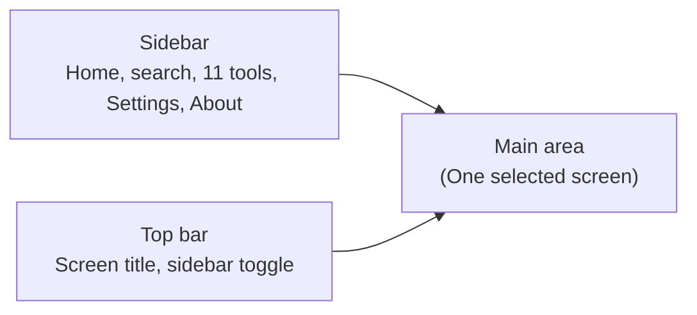

# Application Overview

DevTools is a unified desktop application that combines various development tools into a single, convenient interface.

## Purpose

DevTools eliminates the need for multiple web services by providing all essential developer utilities in one place. Instead of opening multiple browser tabs for different tools, you can access everything from a single application.

## Main Features

| Feature | Description |
|---------|-------------|
| [QR Code](qr-code-generation.md) | Create QR codes for text, URLs, email, phone, SMS, Wi-Fi, contacts, calendar events, and locations |
| [Image Editor](image-processing.md) | Resize, rotate, flip, split images, and make a color transparent |
| [Data Conversion](data-conversion.md) | Convert between JSON, YAML, and TOML formats |
| [HTTP Request](api-testing.md) | Send HTTP requests and view responses |
| [Markdown Preview](markdown-preview.md) | Edit Markdown with real-time HTML preview |
| [Command Generation](command-execution.md) | Build Git and Docker command text from the GUI |
| [Phrase Generation](phrase-generation.md) | Create and reuse text templates |
| [Database](database-management.md) | Connect to databases and execute SQL queries |
| [Regex Tester](regex-tester.md) | Test regular expressions and replacements |
| [Timestamp Conversion](timestamp-conversion.md) | Convert between Unix timestamps, date/time, and ISO 8601 |
| [Text Diff](diff-tool.md) | Compare two texts inline or side by side |

## User Interface

### Layout

### Sidebar

The sidebar provides navigation between tools:

- Search for a tool or select it from the list
- The current tool is highlighted
- Icons help identify each tool quickly

### Main Content Area

The main area displays one selected screen. Settings and About open in dialogs.
Tabs are used only within tools that need them, including HTTP Request and
Database.

### Settings and About

Open either screen from the bottom of the sidebar. Settings is a dialog; About
contains the application information and license.

## Settings

Open **Settings** from the bottom of the sidebar.

### General Settings

- **Language**: Switch between English and Japanese
- **Show sidebar on startup**: Show or hide the sidebar when the app starts
- **Open last used tool on startup**: Restore the last selected tool

The settings dialog also includes options for window behavior and startup
screen restoration.

## Keyboard Shortcuts

| Shortcut | Action |
|----------|--------|
| `Ctrl + W` | Close Window |
| `Cmd/Ctrl + K` | Focus tool search |

## Themes

Choose **Follow system**, **Light**, or **Dark** from **Theme** in Settings.

## Language Support

DevTools is available in:

- **English** (default)
- **Japanese** (日本語)

To change language, open **Settings**, choose **English** or **日本語**, then
click **Save**. The interface changes immediately.

## File Formats

### Supported Input Formats

| Tool | Formats |
|------|---------|
| Image Editor | PNG, JPEG, BMP, GIF, WebP in the Open image dialog; other formats depend on Qt image support |
| Data Conversion | JSON, YAML, TOML |

### Supported Output Formats

| Tool | Formats |
|------|---------|
| QR Code | PNG |
| Image Editor | Formats supported by the installed Qt image plugins |
| Data Conversion | JSON, YAML, TOML |

## System Requirements

- **OS**: macOS 15.0 or later
- **Architecture**: Apple Silicon (arm64)

## Getting Help

- [Common Issues](../troubleshooting/common-issues.md)
- [FAQ](../troubleshooting/faq.md)
- [GitHub Issues](https://github.com/LotusAndCompany/devtools/issues)

## Related Documentation

- [Quick Start](../getting-started/quick-start.md) - Get started quickly
- [Installation](../getting-started/installation.md) - Setup instructions
